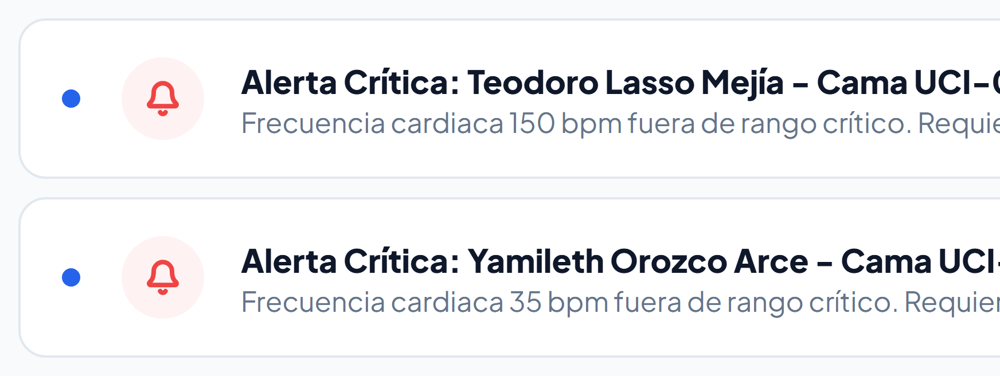
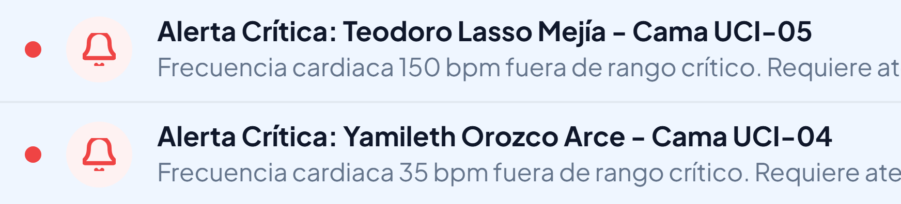
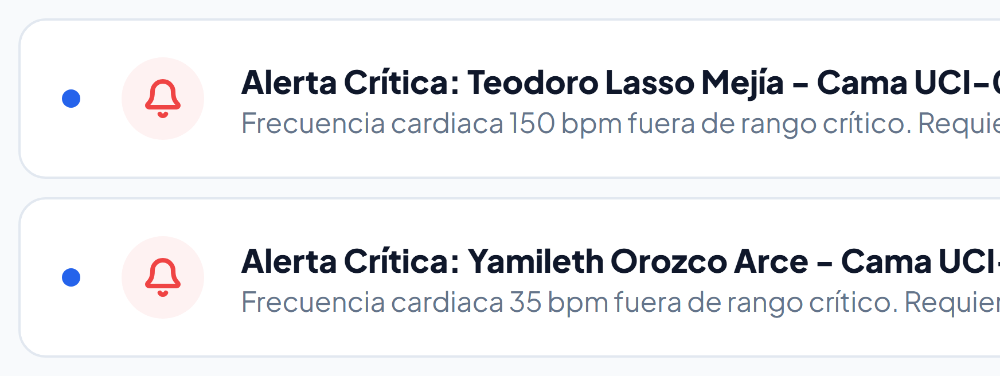
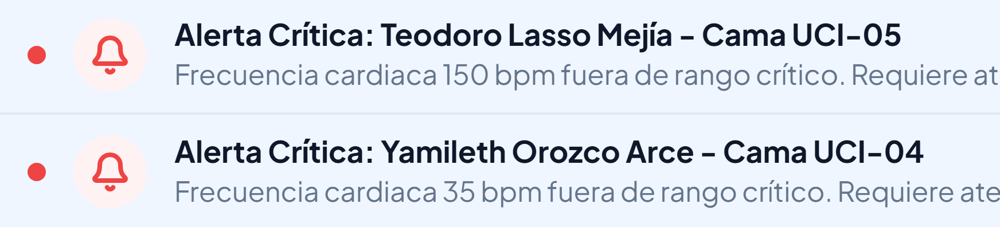
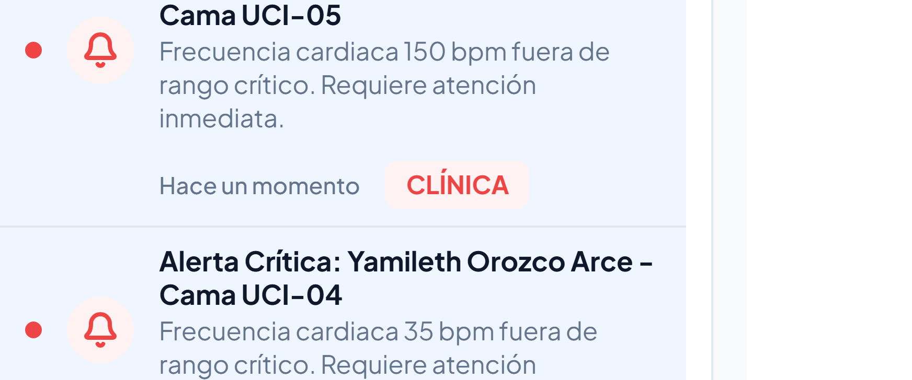

# Conectar el prototipo con el backend real — plan

> **Estado: conectado.** La conexión quedó en **2 PRs**: el 1 (acceso y tablero, sección 10) y los 2 y 3 juntos
> (pacientes, expediente, tiempo real y lo demás, sección 11). Lo publicado en https://prototipo.melo-coton.uk usa
> `VITE_API_MODE=real`: todo va al backend salvo lo que el backend todavía no tiene, que sigue simulado en
> `src/api/sinBackend.ts` (sección 11.2). El modo `mock` se conserva para trabajar sin backend (`npm run dev`).

Fuentes: `backend/src/routes/*.ts`, `backend/src/plugins/auth.ts`, `backend/prisma/schema.prisma`,
`backend/db/seed.sql`, `docker-compose.yml` y, en `frontend/`, `src/shared/api/http.ts`, `src/modules/registry.ts`,
`src/modules/auth/*` y los `api/*.ts` y `types.ts` de cada módulo.

Punto de partida (hecho en el PR 2): las pantallas solo hablan con `src/api/`, cuyos servicios son copias de los de
`frontend/`; el interruptor `VITE_API_MODE=mock|real|mixto` decide si `send()` va al simulador o a `/api`.

---

## 1. `/api` en el mismo dominio

El navegador siempre llama a `/api/...` en el mismo origen, como `frontend/`: sin CORS y sin `ALLOWED_ORIGINS`.
El backend sirve sus rutas en la raíz, así que el proxy quita el prefijo.

### En desarrollo: proxy de Vite

Ya está en `prototipo/vite.config.ts` (igual que en `frontend/`); en modo mock no llega nada a `/api`:

```ts
proxy: {
  '/api': {
    target: 'http://localhost:3001',
    changeOrigin: true,
    rewrite: (path) => path.replace(/^\/api/, ''),
  },
},
```

El proxy de Vite no guarda los flujos SSE, así que `/ai/assist/stream`, `/alerts/stream` y la onda del ECG llegan
trozo a trozo sin configurar nada más. Las cabeceras COOP/COEP que ya tiene el `vite.config.ts` no afectan a `/api`,
que es del mismo origen.

### En el contenedor: nginx del servicio `prototipo`

```nginx
# prototipo/nginx.conf — dentro de server { … }

# DNS interno de Docker. Con el nombre en una variable, nginx lo vuelve a resolver
# en cada petición (cada 10 s como mucho) en lugar de una sola vez al arrancar.
resolver 127.0.0.11 valid=10s ipv6=off;

location /api/ {
  set $backend http://backend:3001;
  # Con una variable en proxy_pass, nginx ya no recorta el prefijo solo.
  rewrite ^/api/(.*)$ /$1 break;
  proxy_pass $backend;

  proxy_http_version 1.1;
  proxy_set_header Connection "";
  proxy_set_header Host $host;
  # $remote_addr y no $proxy_add_x_forwarded_for: ver el comentario de frontend/nginx.conf
  # (el límite de intentos de login se saltaba inventando la cabecera).
  proxy_set_header X-Forwarded-For $remote_addr;
  proxy_set_header X-Forwarded-Proto $scheme;

  # Flujos SSE: /ai/assist/stream, /alerts/stream y /monitoring/:device/waveform.
  proxy_buffering off;
  proxy_cache off;
  # La IA tarda hasta LLM_TIMEOUT_SECONDS=180; los flujos de alertas y ECG mandan un latido cada 25 s.
  proxy_read_timeout 300s;
  proxy_send_timeout 300s;
}
```

**Por qué no da 502 al reconstruir:** `frontend/nginx.conf` usa `proxy_pass http://backend:3001/` fijo. nginx resuelve
`backend` una vez al arrancar y guarda la IP; `docker compose up -d --build backend` crea un contenedor con otra IP y
nginx sigue mandando a la vieja (502) hasta reiniciarlo. Con `resolver` y la variable se resuelve en cada petición.
Además, si `backend` no existe al arrancar, la forma fija no arranca ("host not found in upstream") y la de la
variable sí: el prototipo sigue sirviendo sus pantallas y solo `/api` responde 502. Es lo que hace falta para que la
misma imagen funcione con o sin backend. (Conviene llevar el mismo cambio a `frontend/nginx.conf`; eso es aparte.)

`backend` ya resuelve desde `prototipo`: los dos servicios están en la red por defecto del mismo `docker-compose.yml`.

### Compilar en modo real

Vite fija las variables al compilar, así que el modo va como argumento de construcción:

```dockerfile
# prototipo/Dockerfile, etapa build, antes de `npm run build`
ARG VITE_API_MODE=mock
ENV VITE_API_MODE=$VITE_API_MODE
```

```yaml
# docker-compose.yml, servicio prototipo (fuera de prototipo/: lo cambia el PR de conexión)
prototipo:
  build:
    context: ./prototipo
    args:
      VITE_API_MODE: ${PROTOTIPO_API_MODE:-mock}
```

Sin `depends_on: backend`: el prototipo tiene que arrancar aunque el backend no esté.

### Detrás del túnel de Cloudflare

- **IP real.** El túnel entra por `localhost:8082`, así que para nginx todas las visitas vienen de la misma IP y el
  límite de login (5 intentos en 15 min por IP + correo; 100/min global) se reparte entre todos. Se arregla con
  `set_real_ip_from <IP de cloudflared>;` y `real_ip_header CF-Connecting-IP;` en el `server`.
- **Corte a los 100 s.** Cloudflare corta una respuesta que pasa 100 s sin mandar nada (error 524). Los flujos de
  alertas y ECG mandan latido cada 25 s, pero `/ai/assist/stream` manda `inicio` y después nada hasta el primer
  trozo; en CPU puede pasar del minuto. Pedido al backend (sección 7): un latido mientras piensa.

---

## 2. Login y sesión reales

### Flujo

| Paso | Llamada | Qué hace la app |
|---|---|---|
| Entrar | `POST /auth/login` `{ email, password }` → `{ token, user }` | Guarda `auth.token` y `auth.user` en sessionStorage (mismas claves que `frontend/`; son orígenes distintos, no chocan) y va al Dashboard |
| Recargar | `GET /auth/me` → `User` | Con token, confirma que la sesión sigue viva y refresca el usuario. `frontend/` no lo hace (confía en lo guardado); aquí sí, porque el token vence a las 12 h y una cuenta suspendida deja de entrar en el acto |
| Salir | `POST /auth/logout` → 204 | Revoca el token (`jti`) y deja `LOGOUT` en la bitácora. Si falla, se sale igual. Ya centralizado en `useLogout()` |

### Errores

| Código | Dónde | Qué ve el usuario |
|---|---|---|
| 401 en el login | Credenciales malas o cuenta suspendida (el backend no distingue, a propósito) | "Correo o contraseña incorrectos" |
| 429 en el login | 5 intentos en 15 min | "Demasiados intentos. Espere 15 minutos." |
| 401 en cualquier otra llamada | Token vencido, revocado o cuenta suspendida | Un solo manejador en `http.ts`: borra la sesión, aviso "Su sesión terminó", Login con `?volver=<ruta>` |
| 403 | Falta el permiso del módulo | Esa pantalla muestra "No tiene permiso para ver esto"; la tarjeta de IA no se dibuja (como `frontend/`) |

### Menú y acciones por rol, desde los permisos

El backend decide con `rol_permiso` (módulo × ver/crear/editar/eliminar), consultado en cada petición. Pero
**`/auth/me` no devuelve los permisos**, y `GET /roles/:id/permissions` exige `usuarios:ver`, que solo tiene el admin.
`frontend/` lo resuelve a medias con `requiredRole` fijo en `registry.ts`.

Propuesta:
1. Pedir que `POST /auth/login` y `GET /auth/me` incluyan `permissions: Record<modulo, {ver, crear, editar, eliminar}>`
   (sección 7).
2. Mientras tanto, `can(modulo, accion)` usa una copia de la matriz de `seed.sql` según `user.role`. Si un
   administrador cambia la matriz, el menú puede mostrar algo que el servidor rechace con 403: se ve el aviso de
   permiso, nada se rompe.

| Entrada / acción | Permiso |
|---|---|
| Dashboard, Mis Pacientes, expediente | `pacientes:ver` y `historia_clinica:ver` |
| Monitoreo | `monitoreo:ver` (umbrales: `monitoreo:editar`) |
| Alertas (atender: `alertas:editar`) | `alertas:ver` |
| Reportes | `reportes:ver` |
| Dispositivos | `dispositivos:ver` |
| Nueva Nota SOAP, firmar | `notas_soap:crear` / `notas_soap:editar` |
| Registrar diagnóstico, antecedentes, indicaciones | `historia_clinica:crear` |
| Asistente IA (menú, botón, tarjetas) | `asistente_ia:ver`, **y el rol no es `admin`** |

Con la matriz de hoy: el **médico** ve todo; la **enfermera** ve el expediente y las notas sin escribirlas, puede
atender alertas y no ve la IA; el **administrativo** no tiene pantallas clínicas (su trabajo es Admisión, que el
prototipo no tiene: ve un aviso); el **admin** entra a su sección (`Admin*`). El seed le da `asistente_ia` al admin;
la interfaz se la oculta por rol, como pediste. Conviene quitarla del seed para que el servidor diga lo mismo.

### Lo que el backend no tiene

| Pantalla | Qué pasa en modo real mientras no exista |
|---|---|
| **Código MFA** (`LoginMfa`) | **Decidido:** se queda como paso temporal después del login real. Solo acepta `000000`; con otro código muestra el error y no se entra a la app hasta pasarla (la sesión no se abre del todo). Pendiente para cuando el backend tenga MFA (pedido 17) |
| **Recuperar contraseña** (`RecuperarContrasena`, `RecuperacionEnviada`) | "¿Olvidó su contraseña?" muestra "Pídale al administrador que restablezca su contraseña" |
| **Mi Perfil**: cambiar contraseña, activar MFA, sesiones abiertas | Se ven desactivados, con "Disponible cuando el sistema lo permita" |

---

## 3. Pantalla por pantalla

**Inventado en Parte 1** = lo que hoy sale de `src/api/mock/seed/` con `// no viene del seed` o de `sinBackend.ts`.
Al pasar a real, lo marcado como "falta en el backend" sigue saliendo del simulador o se oculta (se decide en el PR
de cada pantalla).

| Pantalla | Endpoints reales | Tipo de `frontend/` | Falta en el backend | Inventado en Parte 1 |
|---|---|---|---|---|
| Login | `POST /auth/login` | `User`, `Credentials` (auth/types) | — | — |
| LoginMfa | — | — | MFA entero | Todo |
| Recuperar / Recuperación enviada | — | — | Recuperación por correo | Todo |
| Dashboard | `GET /dashboard/assigned-patients`, `GET /sensors/alerts?status=abierta`, `GET /sensors/readings?device&variable` | `AssignedPatient`, `SensorAlert`, `SensorReading` | PA (el tipo dice que no cabe en el modelo) | PA; Glasgow y "evaluado" (vienen de la exploración inventada) |
| Mis Pacientes | `GET /dashboard/assigned-patients` | `AssignedPatient` | Diagnóstico principal en la fila | — |
| Central Grid / Lista | `GET /monitoring/beds?unitId` (las unidades salen de la respuesta) | `MonitoredBed` | PA y temperatura | PA, temperatura, curvas antes de 40 min |
| Comparativa | `GET /sensors/readings?device&variable&limit` por paciente | `SensorReading` | Histórico agregado (`lectura_hora` existe sin endpoint) | Curvas antes de 40 min |
| Resumen | `GET /patients/:id`, `/patients/:id/assignments`, `/historia/:id`, `/soap/notes?patientId`, `/sensors/alerts?device`, `/monitoring/beds`, `/dashboard/devices` | `Patient`, `CareAssignment`, `Expediente`, `SoapNote`, `SensorAlert`, `MonitoredBed`, `DeviceStatus` (`bedApi.ts` ya junta casi todo) | Seguro médico; señal y tiempo encendido del equipo; PA y temperatura | Seguro, PA, temperatura, señal |
| Historia clínica general | `GET /historia/:id`, `GET /historia/:id/cambios` | `Expediente`, `HistoriaChange` | — | Hospitalizaciones, documentos y notas (el seed no trae) |
| Antecedentes | `GET`/`POST /historia/:id/antecedentes` | `Antecedente`, `NuevoAntecedente` | — | — |
| Datos personales | `GET /patients/:id` | `Patient` | Dirección, estado civil, ocupación, aseguradora | Esos campos |
| Diagnósticos activos | `GET /historia/:id` (`diagnosticos`), `POST /historia/:id/evoluciones` (nota correlativa) | `HistoriaEntry` | — | — |
| Registro de diagnóstico | `POST /historia/:id/diagnosticos` | `HistoriaEntry` | Catálogo CIE-10 | Catálogo CIE-10 local (ya existía) |
| Documentos | `GET /historia/:id` (`documentos`), `POST /historia/:id/documentos` | `HistoriaEntry` | Guardar el archivo (el esquema solo guarda la ficha; `PENDIENTE`) | Lista de documentos |
| Exploración física | `GET`/`PUT /historia/:id/exploracion-fisica` | `ExploracionDto` | Signos de la exploración (PA, temperatura) | La exploración de 6 de los 8 |
| Hospitalizaciones | `GET /historia/:id` (`hospitalizaciones`, `procedimientos`) | `HistoriaEntry` | — | Todo (el seed no trae) |
| Indicaciones médicas | `GET /historia/:id` (`medicamentos`), `POST`/`PATCH /historia/:id/medicamentos` | `HistoriaEntry` | Órdenes que no son fármacos (dieta, laboratorios, cuidados) | Esas órdenes |
| Interrogatorio por aparatos | — | — | No existe | Todo |
| Nota de ingreso | — (¿`POST /historia/:id/evoluciones`?) | — | No existe como tal | Todo |
| Monitoreo detallado | `GET /monitoring/beds`, `/sensors/readings`, `/sensors/alerts?device`, SSE `/monitoring/:device/waveform` | `MonitoredBed`, `SensorReading`, `SensorAlert` | Neurológico, ventilación, balance, laboratorios, perfusión; PA y temperatura | Todos esos paneles |
| Notas SOAP (historial, detalle, nueva) | `GET /soap/notes?patientId`, `GET /soap/notes/:id`, `POST /soap/notes` (`sign`), `PUT`/`PATCH /soap/notes/:id`, `POST /soap/notes/:id/sign`, `POST /soap/notes/:id/addendum` | `SoapNote`, `NewSoapNote` | — | Las notas (el seed no trae) |
| Tendencias | `GET /sensors/readings?device&variable&limit` | `SensorReading` | Histórico agregado; PA y temperatura | Curvas antes de 40 min |
| Umbrales | — | — | Umbrales por paciente (hoy fijos en `mqttIngest.ts`) | Todo |
| Centro de alertas | `GET /sensors/alerts?status&severity`, SSE `/alerts/stream` | `SensorAlert` | `patientId` en la alerta (solo trae `device`) | Agrupación (es de la pantalla) |
| Confirmación de atención | — | — | Reconocer o resolver una alerta | Todo |
| Notificaciones (centro y bandeja) | `GET /notifications?page&pageSize`, `POST /notifications/:id/read`, `POST /notifications/read-all` | `Notification`, `NotificationPage` | Tipos que no son alertas | Esos tipos |
| Dispositivos y detalle | `GET /dashboard/devices` | `DeviceStatus` | Firmware, calibraciones, eventos, batería | Esos datos |
| Reportes | `GET /reports/actividad-clinica.csv?desde&hasta` (`descargarActividadClinica`) | — | Reportes clínicos por paciente y su historial (`GET /reports` es otra cosa: las corridas del ETL, tipo `Report`) | Historial de reportes |
| Turno (entrega, historial, recibido) | — | — | No existe | Todo |
| Búsqueda | `GET /search?q` | `SearchResponse` | — | — |
| Mi Perfil | `GET /auth/me` | `User` | Cambio de contraseña, MFA, sesiones, especialidad (la tabla `usuario_especializacion` existe sin endpoint) | Esos datos |
| Ayuda y soporte | — | — | Envío de solicitudes | Todo |
| Asistente IA (nueva) | `POST /ai/assist/stream` (`patientId` obligatorio desde el PR #55) | `AiAssistInput`, `AiStreamHandlers` (aiApi) | Latido mientras piensa | "Lo que verá la IA": se arma en el navegador con `src/lib/aiTemas.ts`, copia de `services/aiTemas.ts`; un endpoint con el contexto evitaría copiar las reglas |
| Ideas de la IA (tarjeta) | `GET /ai/assist/:patientId` y `POST /ai/assist/:patientId/ideas` (a pedido, severidad `solicitado`) | `AiAnalysis`, `AiAnalysisResponse` | `expiresAt` (hoy se calcula con los 15 min de la configuración) | — |

El paciente va en la URL por cédula. En real, `src/api/patients.ts` traduce cédula → id con `GET /patients` (una
llamada en caché) hasta que exista `GET /patients?document=` (sección 7).

---

## 4. Cómo se pasa cada servicio de mock a real

Como el simulador está en la capa HTTP, los servicios **no cambian**: lo que cambia es a dónde va `send()`. Para
conectar por partes (sección 6) el interruptor admite una lista:

```
VITE_API_MODE=mock                    # todo simulado (lo publicado hoy)
VITE_API_MODE=real                    # todo al backend
VITE_API_MODE=mixto
VITE_API_REAL=auth,dashboard,patients # solo estos grupos de rutas van al backend; el resto, al simulador
```

`http.ts` decide por el inicio de la ruta (`/auth`, `/dashboard`, `/patients`, `/historia`, `/soap`, `/monitoring`,
`/sensors`, `/alerts`, `/notifications`, `/reports`, `/search`, `/ai`). En modo mixto los ids del simulador y los del
backend no coinciden, pero las pantallas se hablan por cédula, que es la misma en los dos (DEMO-0001…). Con `auth`
en el backend, el simulador acepta el JWT real y toma el rol de su carga (`src/api/mock/session.ts`), así que los
grupos que siguen simulados responden con los permisos de quien entró.

Para cada grupo, el PR que lo conecta:
1. Lo agrega a `VITE_API_REAL` en `.env.development` y prueba contra el backend con el seed de demo.
2. Compara la respuesta real con la del simulador (mismo tipo); si difieren, se corrige **el simulador**.
3. Revisa los estados de carga, vacío y error de esas pantallas con datos reales.
4. Decide qué hacer con lo que el backend no tiene (seguir simulado con una marca, u ocultarlo).

Al terminar el último grupo, `VITE_API_MODE=real` y el modo mixto se puede quitar.

### React Query: sí

Se agrega en el paso de IA (`REVISION-IA.md`, D7), así que la conexión no lo estrena. Razones:
- `frontend/` ya lo usa: mismas claves (`['patients']`, `['aiAnalysis', id]`…) y los mismos tiempos de recarga, y
  sus componentes se pueden traer casi tal cual.
- Con datos reales hace falta caché entre pestañas del expediente, recargar al volver a la ventana, reintentos
  (salvo 403, como `AiIdeasCard`) e invalidar tras escribir (firmar una nota refresca la lista y el Resumen).
- El flujo de alertas solo tiene que invalidar consultas; no hace falta un estado global aparte.

---

## 5. Tiempo real

| Qué | Cómo llega | Cómo lo usa el prototipo |
|---|---|---|
| **Alertas** | `GET /api/alerts/stream` (SSE). Marcos: `listo`, `alerta` (solo alta y crítica, del hospital del usuario), `notificacion` (cuando el usuario estaba entre los notificados); latido cada 25 s | Una sola conexión para toda la app (copia de `frontend/src/shared/api/alertStream.ts`, `suscribirEventos`). Con `fetch` y no `EventSource`, para mandar `Authorization`; se reconecta a mano. Cada `alerta` invalida alertas, Dashboard, monitoreo y el análisis IA de ese paciente; las críticas muestran un aviso; `notificacion` sube el contador de la campana |
| **Onda del ECG** | `GET /api/monitoring/:device/waveform` (SSE). Marcos: `listo`, `onda` `{ variable, hz, ts, samples }` | Monitor de Resumen y Monitoreo detallado, en un `<canvas>` que avanza a `hz`. Solo llega si el equipo la publica; si no, "Sin señal de ECG". Se cierra al salir de la pantalla (cuesta ancho de banda) |
| **Signos vitales** | No hay flujo: `GET /monitoring/beds` y `GET /sensors/readings` | Se vuelven a pedir cada 15 s (como el tablero de `frontend/`) y en cuanto llega una `alerta`. Un flujo de signos es opcional (sección 7) |
| **Análisis IA** | `GET /ai/assist/:patientId` | Cada 30 s y al llegar una `alerta` de ese paciente (como `AiIdeasCard`) |

---

## 6. Orden de los PRs

El plan eran tres PRs; **el 2 y el 3 se juntaron en uno** (el último). El PR 1 pasó a real sus grupos con el modo
`mixto` (`VITE_API_REAL`); el PR 2+3 pasa todo con `VITE_API_MODE=real`. El detalle de cada uno está en las
secciones 10 y 11.

| # | Rama | Grupos que pasan a real | Lo principal |
|---|---|---|---|
| 1 | `feature/prototipo-conexion-1` | `auth`, `dashboard/assigned-patients`, `sensors` | nginx con `/api`, modo en el build, login real con el código `000000`, sesión, menú por rol, Mi Perfil, Dashboard real; arreglo del ícono de notificaciones |
| 2 y 3 | `feature/prototipo-conexion-2` | todo: `VITE_API_MODE=real` | Las fichas de todos los pacientes asignados con sus 18 pestañas, altas reales, notas SOAP (borrador, firma, adenda, la enfermera solo lee), búsqueda; monitoreo y onda ECG, alertas en vivo, campana, dispositivos, reportes, IA real; publicador de demo; lo simulado, vivo |

**Administración queda fuera** (`/users`, `/roles`, `/permissions`, `/audit`): la conecta quien hace la sección
`Admin*`, en su rama.

---

## 7. Pedidos para el equipo de backend (Adrian)

**Necesarios para conectar sin perder pantallas**

1. **Permisos en la sesión:** que `POST /auth/login` y `GET /auth/me` devuelvan `permissions` del rol. Sin esto el
   menú depende de una copia de la matriz.
2. **Atender una alerta:** `PATCH /sensors/alerts/:id` con `{ status: 'reconocida' | 'resuelta', nota? }`
   (enfermería tiene `alertas:editar` en el seed, pero no hay ruta). Y `patientId` en `SensorAlert`.
3. **Latido en `/ai/assist/stream`:** un comentario `: pensando` cada 15 s hasta el primer trozo, para que Cloudflare
   no corte a los 100 s.
4. **`expiresAt` en el análisis IA** (`GET /ai/assist/:patientId`), para mostrar "caduca en X min" sin copiar la
   configuración.
5. **`GET /patients?document=DEMO-0001`** (o por cédula en `/patients/:id`), para abrir un paciente desde la URL sin
   pedir la lista entera.
6. **Diagnóstico principal en `/dashboard/assigned-patients`**, como ya hace `/search`.
7. **Decidir `asistente_ia` del admin:** el seed se lo da; la interfaz no se lo muestra.

**Pantallas que hoy no tienen dónde guardar** (siguen simuladas hasta que existan)

8. Umbrales por paciente (`GET`/`PUT /patients/:id/thresholds`); hoy están fijos en `mqttIngest.ts`.
9. Histórico agregado de lecturas (`lectura_hora` ya existe): `GET /sensors/readings/hourly?device&variable&desde`.
10. Presión arterial y temperatura: si el monitor no las mide, una captura manual (en la exploración o como lectura
    con dos valores).
11. Entrega de turno (modelo y rutas).
12. Interrogatorio por aparatos y nota de ingreso (o decidir que son evoluciones o notas SOAP de un tipo).
13. Órdenes médicas que no son fármacos (dieta, laboratorios, cuidados).
14. Reportes clínicos por paciente (PDF) y su historial.
15. Guardar el archivo de un documento clínico (el esquema lo deja `PENDIENTE`).
16. Catálogo CIE-10 (`GET /catalogs/cie10?q=`).
17. MFA (TOTP), recuperar contraseña por correo y cambiar la propia.
18. Detalle de dispositivo: firmware, calibraciones, eventos.
19. Datos personales que faltan en `paciente`: dirección, estado civil, ocupación, aseguradora.

**Opcionales**

20. Marca `asistidaPorIa` en la nota SOAP, para auditar qué notas usaron texto de la IA.
21. Flujo SSE de signos vitales, para no repreguntar cada 15 s.
22. Buscar pacientes también por diagnóstico en `/search`.

Los pedidos 23 a 27 salieron del PR 1 (sección 9.5) y los 28 a 33 del PR 2+3 (sección 11.6).

---

## 8. Qué pasa con `frontend/` mientras tanto

- **Sigue siendo la app real** (puerto 8080, servicio `frontend` de `docker-compose.yml`). Solo recibe arreglos: lo
  nuevo se hace en el prototipo (decisión del paso 0, Tailwind), para no hacer todo dos veces.
- **El prototipo es la segunda app** (puerto 8082, https://prototipo.melo-coton.uk). No comparten código: el
  prototipo copia tipos y servicios de `frontend/` y anota de dónde salen. Si un tipo cambia en `frontend/` o en el
  backend, se actualiza la copia en el PR de conexión de ese grupo.
- **Cuándo lo reemplaza:** cuando estén conectados los 3 PRs de la sección 6 (y la sección `Admin*`) y el prototipo
  cubra lo que `frontend/` hace hoy y él no:
  - Admisión: camas, ingresos, egresos y citas (rol administrativo).
  - Ronda en tablet (`/ronda`) y la bandeja de Sensores.
  - Idiomas EN/DE fuera del acceso (`frontend/` traduce todo).
  - Cambios de permisos y bitácora (los lleva la sección `Admin*`).
- **Cómo se reemplaza:** el servicio `frontend` de `docker-compose.yml` pasa a construir `./prototipo` (o se renombra
  la carpeta), en el mismo puerto 8080, con `VITE_API_MODE=real` y el nginx de la sección 1. `frontend/` queda en el
  historial de git y se borra en un PR aparte, cuando nadie lo necesite.

---

## 9. Ejecución

> **Estado: para aprobar.** Fase 1, sin código. Lo marcado **(a aprobar)** es una propuesta mía.

### 9.1 Qué entra en cada PR

Antes de empezar revisé las copias de `src/api/` y `src/api/types/` contra `frontend/` y el backend de hoy (después de
los PRs #54–#58). Solo cambiaron comentarios (traducidos al español); ninguna función, tipo ni ruta. La matriz de
permisos de `seed.sql` es la misma que copia `src/api/permisos.ts`. Cada PR las vuelve a comparar antes de conectar
su grupo.

**Agrupar por ruta, no solo por el primer segmento (a aprobar).** Hoy `VITE_API_REAL=dashboard` manda al backend
todo `/dashboard/*`. Pero el tablero va en el PR 1 y `/dashboard/devices` (dispositivos), en el PR 3. Propongo que
`VITE_API_REAL` acepte prefijos de ruta (`dashboard/assigned-patients`) además de grupos (`dashboard`). Es un cambio
de una línea en `src/api/mode.ts`.

#### PR 1 — acceso y tablero (`feature/prototipo-conexion-1`)

Lo publicado queda en `VITE_API_MODE=mixto` con `VITE_API_REAL=auth,dashboard/assigned-patients,sensors`.

- **nginx del prototipo** (`prototipo/nginx.conf`): la sección 1, tal cual.
  - `resolver 127.0.0.11` con `backend` en una variable, así que se resuelve en cada petición. Si el backend no
    existe o cambia de IP, solo `/api` da 502 y las pantallas siguen.
  - `proxy_buffering off` y `proxy_read_timeout 300s` para los flujos SSE.
  - `X-Forwarded-For $remote_addr`.
  - Opcional: `real_ip` de Cloudflare.
- **Modo en el build:**
  - `prototipo/Dockerfile` recibe `ARG VITE_API_MODE` y `ARG VITE_API_REAL`.
  - El servicio `prototipo` de `docker-compose.yml` los pasa con `${PROTOTIPO_API_MODE:-mixto}` y
    `${PROTOTIPO_API_REAL:-…}`. Los valores por defecto son los de este PR, así que el despliegue automático de `dev`
    toma solo lo publicado.
  - Sin `depends_on: backend`.
  - El modo `mock` sigue siendo el de `npm run dev` sin `.env.local`.
- **Login real:**
  - `POST /auth/login` con las cuentas del seed: 401 → "Correo o contraseña incorrectos"; 429 → "Demasiados
    intentos. Espere 15 minutos."
  - Después, **`LoginMfa` con el código fijo `000000`**; otro código da el error. La sesión no queda abierta hasta
    pasarla: el token se guarda como "pendiente" y las rutas internas mandan a `LoginMfa`.
  - `GET /auth/me` al recargar.
  - `POST /auth/logout` revoca el token.
  - Cualquier 401 → aviso "Su sesión terminó" y Login con `?volver=`.
  - Se quita la entrada automática como médico: solo queda en modo `mock`.
- **Sesión y menú por rol:**
  - El pie del menú y Mi Perfil salen de `/auth/me` (nombre, rol, unidad, correo).
  - El menú y las acciones salen de `can()` con la matriz copiada (sección 2), hasta que el backend mande los
    permisos (pedido 1).
  - Mi Perfil: cambiar contraseña y MFA se ven desactivados, con "Disponible cuando el sistema lo permita".
- **Qué ve cada rol (a aprobar):**
  - **Médico:** todo lo clínico.
  - **Enfermería:**
    - Dashboard y Mis Pacientes con sus pacientes asignados.
    - Expediente y notas de solo lectura (sin "Nueva Nota SOAP" ni altas).
    - Monitoreo, alertas, dispositivos y reportes.
    - Sin IA.
    - Ojo: hoy el seed no le asigna ningún paciente, así que su tablero sale vacío; ver 9.3.
  - **Administrativo** (propuesta: no tiene pantallas propias en el prototipo, porque su trabajo es Admisión):
    - Ve Monitoreo (camas y ocupación, con `monitoreo:ver`, sin abrir el expediente: no tiene `historia_clinica`),
      Dispositivos, Alertas (solo ver) y Reportes.
    - Entra a la Central de monitoreo.
    - El Dashboard no: es "mis pacientes asignados" y nunca tiene.
    - Un aviso en su menú dice que ingresos, egresos y citas están en la app principal (`frontend/`, puerto 8080).
  - **Admin** (propuesta):
    - No ve nada clínico aunque la matriz le dé `ver`: todas las entradas clínicas llevan `hideFor: ['admin']`.
    - Las rutas clínicas le muestran "Esta cuenta es técnica: no ve información clínica".
    - Entra a Mi Perfil hasta que llegue la sección `Admin*`, que pondrá su propia pantalla de inicio.
- **Dashboard real:**
  - `GET /dashboard/assigned-patients`, `GET /sensors/alerts` y `GET /sensors/readings` (tendencias de la tabla).
  - KPIs, tabla, "Requiere tu atención" y minigráficas calculados con esos datos.
  - Nada escrito a mano. Glasgow y "evaluado" vienen del tablero real (`glasgow`, `examined`).
- **El ícono de notificaciones** (9.6).

**Mientras tanto siguen simulados:**
- Expediente, notas, búsqueda, monitoreo, alertas en vivo, campana, dispositivos, reportes e IA.
- Lo de `sinBackend.ts`.

**Efecto visible:**
- El Dashboard real del médico muestra **15 pacientes** (el seed le asigna DEMO-0001…0015). Al abrir DEMO-0009 en
  adelante, el expediente simulado dice "Paciente no encontrado" hasta el PR 2.
- La Central de monitoreo sigue mostrando los 8 del simulador.
- Lo anoto en la descripción del PR.

#### PR 2 — pacientes y expediente (`feature/prototipo-conexion-2`)

Lo publicado queda en `mixto`, con `VITE_API_REAL` = lo del PR 1 + `patients,historia,soap,search`.

- **Pacientes:**
  - `GET /patients` (cédula → id, en caché) y `GET /patients/:id`.
  - Asignaciones (`/patients/:id/assignments`).
  - Las fichas de **todos** los pacientes del médico, no solo de los 8.
- **Expediente** (`/historia`):
  - Lectura de todas las categorías y altas reales: antecedentes, diagnósticos (con el CIE-10 local),
    medicamentos, documentos (solo la ficha) y evoluciones (nota correlativa).
  - `PATCH` de observaciones y `PUT` de la exploración física. Después de escribir, se invalida lo que corresponde.
- **Notas SOAP** (`/soap`):
  - Borrador (`POST` sin `sign`, `PUT`/`PATCH`), firma (`POST /sign`), adenda (`POST /addendum`).
  - Una nota firmada no se edita: el backend da 409 y la interfaz ni lo ofrece.
  - La enfermera solo lee (sin botones; si forzara, 403 → aviso).
  - La casilla de D8 sigue igual.
- **Búsqueda** real (`/search`).
- **`sinBackend.ts` sin 404:** hoy lo inventado está por cédula y solo existe para DEMO-0001…0008. Para cualquier otro
  paciente real devuelve "sin dato" y las pantallas muestran "—" o "Sin registro". Aplica a: PA, temperatura, nota de
  ingreso, interrogatorio, indicaciones no farmacológicas, paneles del monitoreo detallado, umbrales y turno. Queda
  marcado en el código ("simulado: falta en el backend") y en los pedidos.

**Mientras tanto siguen simulados:** monitoreo, alertas en vivo, campana, dispositivos, reportes, IA y lo de
`sinBackend.ts`.

#### PR 3 — tiempo real y lo demás (`feature/prototipo-conexion-3`)

Lo publicado queda en **`VITE_API_MODE=real`**: solo lo de `sinBackend.ts` sigue simulado.

- **Monitoreo:**
  - `GET /monitoring/beds?unitId`: las unidades salen de la respuesta y las camas libres, también.
  - La onda ECG en vivo (`GET /monitoring/:device/waveform`, SSE) en el Resumen, el Monitoreo detallado y las
    tarjetas de la central, en un `<canvas>`. Si no llega señal: "Sin señal de ECG".
- **Alertas en vivo:**
  - `GET /alerts/stream` (una conexión para toda la app).
  - Centro de alertas real; "atender" sigue simulado hasta que exista la ruta (pedido 2).
- **Campana y notificaciones:** `GET /notifications`, `POST /notifications/:id/read` y `POST /notifications/read-all`.
  Los tipos que el backend no da se quitan, no se inventan.
- **Dispositivos:** `GET /dashboard/devices` (estado, última lectura). Firmware, calibraciones y eventos siguen
  simulados (pedido 18).
- **Reportes:** `GET /reports` (corridas del ETL) y el CSV de actividad clínica. Los reportes clínicos por paciente
  siguen simulados (pedido 14).
- **IA real** (`/ai`):
  - El modelo del servidor, con sus tiempos reales (30 s a 1,5 min).
  - "Detener" corta la generación.
  - 403 de enfermería, 503 con el modelo apagado.
  - Ideas a pedido y análisis automático.
- **Se quita el modo `mixto`** del build publicado; el código lo conserva para trabajar por partes.

### 9.2 Cómo se actualiza cada dato en vivo

| Dato | Cómo llega | Cada cuánto / cuándo | Si se cae la conexión |
|---|---|---|---|
| Alertas nuevas | SSE `/alerts/stream`, una sola conexión (`suscribirEventos`) | Al instante. Cada `alerta` invalida alertas, tablero, camas, notificaciones y el análisis IA de ese paciente; las críticas muestran un aviso | Reintenta cada 3 s (como `frontend/`). Mientras tanto, un aviso discreto en la barra: "Sin conexión en vivo; reintentando". Las recargas de abajo siguen, así que nada se queda congelado |
| Campana | Marco `notificacion` del mismo flujo + `GET /notifications` | Al instante, y cada 60 s por si acaso | Igual que arriba |
| Signos vitales (tablero, central, resumen, monitoreo) | `GET /dashboard/assigned-patients`, `/monitoring/beds`, `/sensors/readings` (no hay flujo de signos) | Cada 15 s (como el tablero de `frontend/`) y en cuanto llega una `alerta` | La consulta queda en error: se muestra el último dato con "hace X" y el aviso de conexión; reintenta en la siguiente vuelta |
| Tendencias y minigráficas | `GET /sensors/readings?device&variable&limit` | Cada 60 s | Igual |
| Onda ECG | SSE `/monitoring/:device/waveform`, solo mientras se mira esa cama | Al ritmo del equipo (`hz`); se cierra al salir de la pantalla | Reintenta cada 3 s; si pasan 5 s sin muestras, "Sin señal de ECG" |
| Dispositivos | `GET /dashboard/devices` | Cada 30 s (el estado lo mueve el MQTT `status`) | Igual que signos |
| Análisis IA | `GET /ai/assist/:patientId` | Cada 30 s y con cada `alerta` del paciente | La tarjeta muestra su error con "Reintentar" |
| Sesión | Cualquier 401 | — | Se cierra y va al Login con `?volver=` |

Reglas comunes:
- Las recargas se pausan con la pestaña oculta y se hace una al volver (`refetchOnWindowFocus` en modo real).
- Si el backend no responde (502), cada pantalla muestra su estado de error con "Reintentar", más el aviso de
  conexión en la barra.

**Para que los datos se muevan hace falta quien los publique (a aprobar).** Las lecturas de `seed-demo.sql` son de
los 40 minutos anteriores a cargarlo y **no avanzan solas**. El README lo dice: "se desactualizan". Sin un equipo
publicando por MQTT, el prototipo real muestra todo "hace 3 h", sin alertas nuevas ni onda ECG. Propuesta:
- Un **publicador de demo** en `prototipo/tools/telemetria-demo/`, un script de Node:
  - Por cada `DEMO-DEV-xx` publica `hr`, `spo2` y `resp` una vez por segundo, continuando la serie de cada paciente:
    el que viene en bradicardia sigue en bradicardia.
  - Publica la onda ECG con el formato de `backend/src/services/waveform.ts`.
  - Usa el tema y las credenciales MQTT del `.env`.
- Se corre con `docker run` en la red de Compose, local y en el servidor, y lo detienes cuando quieras.
- Las lecturas fuera de rango generan alertas reales y disparan el análisis automático de la IA.
- Alternativa: `iot/src/main.py --simulate` con un proceso por equipo, pero da valores genéricos que no siguen el caso
  de cada paciente.
- A largo plazo, que Adrian lo adopte como servicio `demo` del Compose (pedido 23).

### 9.3 Qué datos necesita la base y cómo revisarlos

La base del servidor (y la local) necesita:

1. **El seed base** (`schema.sql` y `seed.sql`): se aplica solo al crear el volumen.
2. **`seed-demo.sql`**: los 18 pacientes `DEMO-*`, sus camas, equipos `DEMO-DEV-*`, lecturas y alertas. Se aplica
   **una sola vez**: falla si ya existen.
3. **Los parches**, que se pueden correr varias veces:
   - `backend/db/parches/2026-11-23-permiso-asistente-ia.sql` (permiso de la IA).
   - `backend/db/parches/2026-11-24-notas-soap-demo.sql` (una nota firmada por paciente `DEMO-*`).
4. **Pacientes asignados a la enfermera.** El seed solo asigna al médico (15 filas en `medico_paciente`). Los asigna
   `asignar-enfermeria.sql` (abajo), y va como pedido 24 para que lo traiga el seed.

**Revisar y cargar** con `prototipo/tools/base/base.sh`. Corre dentro del contenedor de MariaDB, con sus propias
variables, así que no se escriben contraseñas y funciona igual en PowerShell y en Git Bash. Desde la raíz; en el
servidor, con `-f docker-compose.yml -f docker-compose.prod.yml`:

```
docker compose cp backend/db mariadb:/tmp/db
docker compose cp prototipo/tools/base mariadb:/tmp/base
docker compose exec mariadb sh /tmp/base/base.sh revisar
docker compose exec mariadb sh /tmp/base/base.sh cargar
```

`revisar` solo lee (`revisar.sql`). Lo esperado:
- 18 pacientes y al menos 18 notas.
- `medico 15`, y `enfermero 15` después de cargar.
- `permiso_ia 1`.
- Una `ultima_lectura` de hace segundos si el publicador está corriendo.

`cargar` se puede repetir sin problema:
- Aplica `seed-demo.sql` solo si no hay pacientes DEMO.
- Corre los dos parches.
- Asigna a la enfermera los pacientes DEMO del médico (`asignar-enfermeria.sql`). Es por SQL y no por la API, para no
  poner contraseñas en un script; es dato de demo, como el seed.
- Termina con la revisión.

Si `seed-demo.sql` ya estaba cargado y las lecturas quedaron viejas, no se vuelve a cargar: el publicador de demo
(9.2) es lo que las pone al día.

### 9.4 Cómo voy a probar contra el backend real en local

1. **Levantar el Compose de la raíz:** `docker compose up -d --build`, con el `.env` del equipo, y esperar a que
   `http://localhost:3001/health` responda.
2. **Cargar los datos** de 9.3 (tú corres los comandos; yo solo leo).
3. **Publicador de demo** (9.2) corriendo, para tener lecturas, alertas y onda en vivo.
4. **El prototipo, de dos formas:**
   - `npm run dev` con `prototipo/.env.local` en `mixto`/`real` (proxy de Vite a `localhost:3001`).
   - El contenedor: `docker compose --profile prototipo up -d --build prototipo`, en `http://localhost:8082`, para
     probar el nginx, los flujos sin búfer y el 502 con el backend apagado.
5. **Pruebas automáticas** (Edge sin ventana, como en `REVISION-IA.md`), entrando con las 4 cuentas del seed:
   - Médico: todo.
   - Enfermera: solo lectura, sin IA.
   - Administrativo: lo de 9.1.
   - Admin: nada clínico.
   - Además, cada PR prueba lo suyo y el modo `mock` sigue pasando sus pruebas.
6. **Capturas** a 1440, 1024 y 390 sin desplazamiento lateral.
7. **IA (PR 3):** necesita Docker Model Runner con el modelo `medgemma-4b-it` descargado.

**Qué falta hoy para poder probar** (revisado en este equipo):
- **Docker Desktop no está corriendo:** el motor no responde (`docker ps` falla). Hay que abrirlo.
- Compose está instalado (v5.1.3), el `.env` de la raíz existe y los certificados del broker están en
  `infra/mosquitto/certs/`.
- Para el PR 3: el modelo en Docker Model Runner (`docker model pull` del modelo de `LLM_MODEL`; unos 2,5 GB) y Model
  Runner activado en Docker Desktop.
- No sé si la base del servidor tiene `seed-demo.sql` y los parches: hay que correr la revisión de 9.3 allá.

### 9.5 Pedidos para Adrian (actualiza la sección 7)

Siguen los de la sección 7, con estos cambios:

- **El 7 (`asistente_ia` del admin):** la interfaz se lo oculta, y ahora tampoco ve nada clínico. Conviene alinear la
  matriz: `ver` sin necesidad para el admin en `pacientes`, `historia_clinica`, `notas_soap`, `monitoreo` y
  `alertas`.
- **El 17 (MFA)** pasa a tener efecto en la interfaz: mientras no exista, `LoginMfa` acepta `000000`.

Pedidos nuevos:

23. **Publicador de telemetría de demo** como servicio opcional del Compose (perfil `demo`), para que el servidor tenga
    datos vivos sin depender de que alguien lo corra.
24. **Asignar los pacientes `DEMO-*` también a la enfermera** en `seed-demo.sql` (hoy solo al médico), para que su
    tablero no salga vacío.
25. **`refresh` de las lecturas del seed:** un parche que mueva las lecturas y alertas de `seed-demo.sql` a "ahora"
    (o que el seed las cree relativas al arranque), para demos sin publicador.
26. **Médico y `alertas:editar`:** hoy el médico solo puede ver alertas; cuando exista "atender" (pedido 2), decidir si
    también las atiende (en Figma, sí).
27. **El límite de login cuenta también los intentos buenos** (`max: 5` cada 15 min por IP y correo, sin
    `skipSuccessfulRequests`). Con las cuentas de demo compartidas, cinco entradas seguidas a `medico@institucion.org`
    la bloquean 15 minutos, aunque todas sean correctas; pasó en las pruebas del PR 1. Propuesta: contar solo los
    fallidos. Mientras tanto, el nginx del prototipo toma la IP real de Cloudflare (`CF-Connecting-IP`), así cada
    visitante tiene su propio contador.

### 9.6 El ícono de notificaciones

Revisé con capturas a 1440, 1024 y 390 px:
- la campana de la barra superior;
- los íconos de cada aviso en la bandeja (`Notificaciones`, nodo 48:447);
- los íconos de cada aviso en el Centro (`MedNotificacionesCentro`, nodo 333:4).

Las ampliaciones del antes están en `docs/conexion/`.

| Bandeja 1440 | Centro 1440 | Centro 390 | Campana |
|---|---|---|---|
|  |  |  |  |

Qué está mal:

1. **Recorte en el Centro.** `bell-6.svg`, `bell-7.svg`, `users-5.svg`, `file-text-5.svg` y `cpu-4.svg` se exportaron de
   Figma con el dibujo más grande que su caja: coordenadas de −0,34 a 16,33 en un `viewBox` de 16. Con el trazo de
   2 px, el borde se corta por los cuatro lados.
   - A la campana le queda la base plana y el badajo reducido a una rayita suelta.
   - Pasa igual en los tres anchos: es el archivo, no el diseño adaptable.
2. **Trazo grueso en la bandeja.** `bell-4.svg` y `bell-5.svg` sí caben, pero su trazo de 2 px en 16 px convierte el
   badajo (un arco de radio 1,3) en una gota rellena.
3. **Ícono equivocado en la bandeja:**
   - La asignación de un paciente lleva el chip de CPU (`cpu-2.svg`).
   - La nota SOAP lleva el de personas (`users-4.svg`).
   - Así venía de Figma, pero el Centro (333:4) usa personas para la asignación y portapapeles para notas y
     recordatorios: el mismo aviso se ve con dos íconos distintos según la pantalla.
4. **La campana de la barra superior está bien:** es `IconBell` de `icons.tsx` (Lucide, 18 px, trazo de 2 px sin
   escalar). El contador rojo tampoco tapa nada.

Arreglo propuesto (PR 1):
- Los íconos de los avisos dejan de ser los SVG exportados y pasan a los de `icons.tsx` (`IconBell`, `IconUsers`,
  `IconClipboard`, `IconFileText`, `IconCpu`, `IconActivity`, y uno nuevo `IconCheckCircle`). Toman el color del tema
  (`text-danger`, `text-warning`…), así que no se recortan y su trazo es el del resto de la interfaz.
- Una sola tabla tipo → ícono y color para las dos pantallas, en `src/data/notifications.ts`:

  | Tipo | Ícono |
  |---|---|
  | Alerta crítica | campana roja |
  | Alerta temprana | campana ámbar |
  | Asignación | personas |
  | Laboratorio, imagen | documento |
  | Nota o recordatorio | portapapeles |
  | Sistema | chip |

- Los SVG viejos se quedan en `src/assets/` por la rama del administrador.
- Verificación: las mismas capturas del después a 1440, 1024 y 390.

---

## 10. PR 1 — acceso y tablero

Rama `feature/prototipo-conexion-1`. Lo publicado queda en `mixto` con `auth,dashboard/assigned-patients,sensors`.

**Cómo quedó**

- **nginx y build:**
  - `prototipo/nginx.conf`: proxy de `/api` con `resolver`, sin búfer y con 300 s para los flujos. Toma la IP real
    de Cloudflare (`CF-Connecting-IP`, solo desde la red local o de Docker), para que el límite de login sea por
    visitante (pedido 27).
  - `prototipo/Dockerfile`: `ARG VITE_API_MODE` y `VITE_API_REAL`.
  - `docker-compose.yml`, servicio `prototipo`: los pasa como `PROTOTIPO_API_MODE` y `PROTOTIPO_API_REAL`, sin
    `depends_on`.
- **`src/api/mode.ts`:** `VITE_API_REAL` acepta grupos (`sensors`) o rutas (`dashboard/assigned-patients`).
  `REAL_AUTH` dice si el login es el del backend.
- **Sesión** (`components/auth/session.tsx`):
  - Login real y después `LoginMfa`. La sesión queda "pendiente" hasta poner 000000; con otro código, "El código no
    es válido". La pantalla avisa del código temporal.
  - Con el login real ya no se entra solo como el médico.
  - `/auth/me` al abrir la app.
  - Un 401 vuelve al Login y, al entrar, a la pantalla donde estaba.
  - La pantalla de inicio depende del rol (`landingFor`).
- **Por rol:**
  - `nav.ts`: cada entrada dice qué permisos necesita y a quién no se le muestra.
  - `RoleGuard` (alrededor de las rutas en `App.tsx`): una ruta sin permiso muestra "No tiene permiso para ver esto",
    y una clínica para el admin, "Esta cuenta es técnica".
  - Campana: solo con `alertas:ver` y sin el admin.
  - Las camas no abren el expediente sin `historia_clinica` (administrativo), que además ve el aviso de Admisión.
- **Mi Perfil y el pie del menú:**
  - Salen de la sesión: nombre con su título, rol, unidad, correo, teléfono y última actividad.
  - Iniciales en lugar de la foto de Figma.
  - Se quitaron la especialidad, la cédula profesional, los años y el turno inventados.
  - "Ahora mismo" calcula pacientes a cargo y sus alertas abiertas.
  - Con el login real, cambiar la contraseña y MFA quedan desactivados.
- **Dashboard:**
  - Ya leía todo de `src/api/`. Con datos reales, se recarga cada 15 s y al volver a la pestaña.
  - El título de las tendencias ya no dice "Últimas 4 Horas" (son las últimas lecturas).
- **Íconos de notificaciones:**
  - `components/ui/NotificationIcon.tsx`, una sola tabla para las dos pantallas, con los íconos de `icons.tsx` a
    18 px.
  - Ver 9.6.

| Después: bandeja 1440 | Centro 1440 | Centro 390 |
|---|---|---|
|  |  |  |

**Verificación**

- `npm run build` y `tsc` pasan, en modo `mock` y en `mixto` con las rutas del PR 1.
- **Modo `mock`** (pruebas automáticas de Edge sin ventana):
  - **Sesión:** otro código que no sea 000000 da error, y mientras tanto ninguna pantalla de adentro se abre.
  - **Roles:**
    - Administrativo: entra a la central, sin Dashboard, Pacientes ni IA; las camas no abren el expediente.
    - Admin: entra a Mi Perfil, sin menú clínico ni campana; una pantalla clínica dice "cuenta técnica".
    - Médico: Mi Perfil con sus datos y cifras calculadas.
  - Las pruebas anteriores (fichas, listas, IA, sesión) siguen pasando.
- **Contra el backend real** (Compose local con `seed-demo.sql`, los parches y `base.sh cargar`; prototipo en
  `mixto`):
  - **Login:**
    - Sin sesión no se entra solo.
    - Contraseña equivocada → "Correo o contraseña incorrectos" (401); muchos intentos → "Demasiados intentos" (429).
  - **Médico:**
    - Entra con 000000 y llega al Dashboard real: 16 asignados (incluye DEMO-0009 en adelante), 5 críticos y
      16 pendientes de evaluación (la base no tiene exploraciones).
    - Mi Perfil con `/auth/me` y la misma cifra.
    - Recargar conserva la sesión.
    - Cerrar sesión revoca el token: el mismo token da 401 en `/auth/me`.
    - Con un token vencido va al Login con el aviso y vuelve a la pantalla donde estaba.
  - **Enfermería:** su tablero con sus 16 asignados, sin IA.
  - **Administrativo:** entra a la central, sin Dashboard ni Pacientes.
  - **Admin:** sin menú clínico ni campana; una pantalla clínica dice "cuenta técnica".
  - **Contenedor** (`docker compose --profile prototipo up -d --build prototipo`, en 8082):
    - Sirve las pantallas, pasa `/api` al backend y trae compilado el modo del PR 1.
    - Con el backend apagado, las pantallas siguen y solo `/api` da 502. Al recrear el backend, vuelve solo, sin
      reiniciar el prototipo.
    - El flujo de alertas llega en 84 ms (sin búfer).
    - Con `CF-Connecting-IP`, el backend ve la IP del visitante.
  - **Capturas** con la sesión del médico a 1440, 1024 y 390 (Dashboard, Mi Perfil, notificaciones, central): sin
    desplazamiento lateral ni textos cortados.
- **Lo que se ve y no es error:**
  - Las lecturas y alertas son las de `seed-demo.sql` ("hace 22 min") porque nadie publica por MQTT (9.2,
    publicador de demo, PR 3).
  - Abrir un paciente más allá de los 8 da "Paciente no encontrado" hasta el PR 2.
- **Ojo con las pruebas:** el backend permite 5 logins por IP y correo cada 15 min, contando también los buenos
  (pedido 27). Repetir las pruebas reales seguidas bloquea la cuenta 15 minutos.

---

## 11. PRs 2 y 3 — pacientes, expediente, tiempo real y lo demás (un solo PR)

Rama `feature/prototipo-conexion-2`, creada desde `feature/prototipo-conexion-1`. Los PRs 2 y 3 de la sección 6 van
juntos. Lo publicado queda en `VITE_API_MODE=real`: el servicio `prototipo` de `docker-compose.yml` lo trae por
defecto (`PROTOTIPO_API_MODE`, con `PROTOTIPO_API_REAL` vacío). Todo va al backend salvo lo de
`src/api/sinBackend.ts`, que sigue simulado. El modo `mock` se conserva: `npm run dev` sin `.env.local`.

### 11.1 Qué quedó real

| Área | Del backend | Cómo se ve |
|---|---|---|
| Pacientes y expediente | `/patients`, `/historia/:id` (y `cambios`, `observaciones`), `/exploracion` | Todos los pacientes que la base le asigna a la persona (16 en la base de demo, no solo los 8), con sus 18 pestañas |
| Altas | `POST/PATCH /historia/:id/<categoría>` | Diagnósticos, antecedentes, alergias, medicamentos, documentos (la ficha; el archivo no, pedido 15) |
| Notas SOAP | `/soap/notes` | Borrador, seguir el borrador, firmar; una nota firmada no se edita (el backend responde 409) y se corrige con una **adenda** (nueva en el detalle, `POST /soap/notes/:id/addendum`). La enfermera solo lee |
| Búsqueda | `/search` | Pacientes, notas y documentos |
| Monitoreo | `/monitoring/beds` | La central por unidad (UCI, Trauma, Admisión y Piso 3 en la base de demo), con las unidades que trae la respuesta |
| Onda del ECG | SSE `/monitoring/:device/waveform` | En Resumen y en Monitoreo detallado (`components/monitor/EcgLive.tsx`), con "Sin señal de ECG" si en 5 s no llega nada |
| Alertas en vivo | SSE `/alerts/stream`, `/sensors/alerts` | `components/layout/EnVivo.tsx`: una alerta nueva refresca alertas, pacientes y camas sin esperar; una crítica de un paciente a cargo muestra un aviso (uno por paciente por minuto); "Sin conexión en vivo" junto a la campana si el flujo se corta |
| Campana y bandeja | `/notifications` | Solo las reales; las de otro tipo (asignación, laboratorio…) quedan para el modo mock |
| Dispositivos | `/dashboard/devices` | Los 16 equipos (los 15 de demo y la Raspberry `RPI-01`), con la cama de `/monitoring/beds` y las señales de las lecturas recientes |
| Reportes | `/reports`, `/reports/actividad-clinica.csv` | Pestaña nueva "Informes del Sistema": la bitácora del ETL y la descarga del CSV por rango de fechas |
| IA | `/ai/assist/stream`, `/ai/assist/:id`, `/ai/assist/:id/ideas` | El modelo real (`LLM_URL`). Enfermería: 403. Con el modelo apagado: 503, "no está disponible" y Reintentar |

### 11.2 Qué sigue simulado, y vivo

Lo que el backend no tiene sigue en `src/api/sinBackend.ts`, marcado `SIMULADO` en el código. Ya no son números fijos:

- **Cambia con el tiempo** (`src/api/simulacion.ts`). PA, temperatura, tendencias y los paneles del monitoreo detallado
  (neurológico, respiratorio, balance, laboratorios, perfusión) oscilan despacio alrededor del valor de cada caso.
  - Es una suma de senos con fases propias de cada paciente y signo, sin azar: dos pantallas abiertas dicen lo mismo.
  - Los periodos van de minutos (PA, diuresis) a horas (laboratorios).
  - Las pantallas lo vuelven a pedir cada 15 s.
  - El último punto de las tendencias es el valor que muestran las demás pantallas.
- **La temperatura es la del monitor** cuando el backend la tiene: el publicador de demo manda `temp`, que está en el
  catálogo `variable` y no tiene umbral. Si no hay una lectura de los últimos 10 minutos, se usa la simulada.
- **Los pacientes que no son de los 8** (DEMO-0009 en adelante, o cualquiera que se dé de alta) tienen un **perfil
  generado** (`perfilGenerado`, con `generado: true`). Sale de su motivo de consulta (cardiológico, respiratorio,
  infección, trauma, obstétrico, abdominal, metabólico, neurológico, musculoesquelético o general), de su edad, de su
  sexo y de la gravedad de sus alertas.
  - Trae datos personales, PA y temperatura, signos de ingreso, los paneles del monitoreo, nota de ingreso,
    interrogatorio por aparatos, indicaciones, nota correlativa, entrega de turno y tendencias.
  - Los textos usan las observaciones y los diagnósticos reales del expediente.
  - Con una alerta crítica, una infección o un trauma empeoran la perfusión (PA baja, lactato, diuresis).
  - En pantalla no lleva una marca propia, igual que lo simulado de los 8.

| Simulado | Falta en el backend (pedido) |
|---|---|
| Presión arterial y PAM; temperatura sin monitor | PA como lectura (10) |
| Datos personales (estado civil, ocupación, dirección, aseguradora) | Campos en `paciente` (19) |
| Signos vitales de ingreso | La exploración solo guarda Glasgow |
| Paneles del monitoreo detallado | No son telemetría; serían laboratorios y balance (13) |
| Nota de ingreso e interrogatorio por aparatos | Modelo y rutas (12) |
| Indicaciones que no son fármacos | Órdenes médicas (13) |
| Nota correlativa de diagnósticos | ¿`notas` de cada diagnóstico? |
| Entrega de turno | Modelo y rutas (11) |
| Tendencias de PA (FC, SpO2, FR y temperatura ya son lecturas reales) | Histórico agregado (9) y PA (10) |
| Umbrales por paciente | `thresholds` (8) |
| Reportes clínicos por paciente | Reportes PDF (14) |
| Batería, calibraciones, firmware y eventos de los equipos | Detalle de dispositivo (18) |
| El trazo de ECG de las tarjetas de la central (corre a la FC real de cada cama) | Onda de varios equipos en un flujo (29) |

### 11.3 Publicador de demo

`prototipo/tools/telemetria-demo/` ([LEEME](tools/telemetria-demo/LEEME.md)): un script de Node que hace de los
15 monitores `DEMO-DEV-*`.

- Publica por MQTT, igual que la Raspberry: TLS, el usuario del `.env` y el formato de `mqttIngest.ts`.
- Cada 30 s manda `hr`, `spo2`, `resp` y `temp` (`PERIODO_S`).
- Cada segundo manda la onda del ECG a 125 Hz, con fibrilación auricular en DEMO-0005.
- Al arrancar y al salir manda el estado `online` u `offline`.
- Los valores siguen el caso de cada paciente (`casos.json`). Los críticos quedan cerca de su umbral y lo cruzan en
  episodios cortos, no en cada lectura: hoy el backend crea una alerta, y una notificación por usuario a cargo, por
  cada lectura fuera de rango (pedido 28).
- `--alerta DEMO-DEV-06` manda una sola lectura crítica (FC 150), para mostrar el aviso en vivo.
- `--historia 24h --una-vez` carga una sola vez las lecturas de las últimas 24 h, cada 5 min y dentro de los
  umbrales, para que las tendencias tengan historia (sección 12.1).
- Se corre con `docker run` en la red `siappc_default`; no es un servicio del Compose (pedido 32).

### 11.4 Verificación

- `npm run build` y `tsc` pasan.
- **Modo mock:** la suite de pruebas automáticas (Edge sin ventana) pasa entera, 59 pruebas: fichas, recarga, listas,
  IA, sesión y roles.
- **Contra el backend local**, con la base de demo, el publicador corriendo y el prototipo en `real`. Se entró pocas
  veces por cuenta (el límite es de 5 cada 15 min, pedido 27).
  - **Médico:**
    - Las 18 pantallas de cada uno de sus 16 pacientes, sin "Cargando" colgado, sin textos rotos ni errores de
      consola.
    - Los signos de Resumen cambian solos sin recargar, y la onda del ECG llega en vivo.
    - DEMO-0009, DEMO-0010 y DEMO-0012 muestran sus perfiles generados (insuficiencia cardíaca con BNP, plan de asma,
      datos personales).
    - Una alerta crítica nueva (`--alerta`) muestra el aviso al instante, sube la campana y aparece en el centro de
      alertas.
    - Dispositivos lista los 16 equipos. Reportes descarga el CSV (200, `text/csv`). La bandeja solo trae las reales.
    - Nota SOAP: borrador, firma, la firmada no se edita (409) y una adenda firmada que cuelga de la nota.
    - Alta real: un diagnóstico I50.9 registrado desde la pantalla aparece en Diagnósticos activos.
  - **Enfermería:**
    - 403 en la IA, en la consulta y en el análisis.
    - Lee la nota firmada y su adenda, sin poder editar ni agregar.
    - Ve la onda del ECG y recibe el aviso de la alerta crítica.
  - **Administrativo:** la central real con sus 4 unidades; las camas no abren el expediente; el trazo de las
    tarjetas corre a la FC de cada cama.
  - **Admin:** entra a Mi Perfil, sin campana ni flujo de alertas.
  - **IA con el modelo apagado:** 503, el aviso y Reintentar.
  - **IA con el modelo:** un contenedor de Ollama local con el modelo del servidor
    (`hf.co/Mungert/medgemma-4b-it-GGUF:Q4_K_M`, en CPU). El backend apuntó a él con un override de Compose temporal,
    sin tocar el `.env`, y después volvió a su configuración.
    - Una consulta tardó 18 s en empezar a escribir y 24 s en total.
    - "Detener" la cortó en 0,1 s.
    - Las ideas a pedido de DEMO-0009 tardaron 22 s; la primera fue "Descompensación de la insuficiencia cardíaca".
    - El análisis automático por alerta también corrió.
  - La corrida final de las 16 fichas (288 pantallas), con una pausa breve entre pantallas, pasa entera y sin
    reintentos por el techo de peticiones (pedido 33).
  - **PENDIENTE:** las capturas a 1440, 1024 y 390 px.
- **Lo que se ve y no es error:**
  - Las pruebas dejaron en la base local tres notas SOAP en DEMO-0009: un borrador, una firmada y su adenda. También
    un diagnóstico I50.9 de prueba y dos alertas de FC 150 en DEMO-0006.
  - Con el publicador corriendo, la campana acumula decenas de notificaciones por hora (pedido 28).

### 11.5 Qué correr en el servidor después de mezclar

Desde `/opt/siappc`, con `-f docker-compose.yml -f docker-compose.prod.yml` en cada `docker compose`:

1. **El prototipo en modo real:** `git pull` y
   `docker compose -f docker-compose.yml -f docker-compose.prod.yml up -d --build prototipo`.
2. **Los datos** (9.3): `base.sh revisar` y, si falta algo, `base.sh cargar`. Deja los 18 pacientes DEMO, las notas
   y la enfermera con sus pacientes.
3. **El publicador de demo:** construir la imagen y dejarla corriendo con `--restart unless-stopped`
   (comandos en [su LEEME](tools/telemetria-demo/LEEME.md)).
4. **El modelo:** el backend tiene que apuntar al Ollama del servidor (`LLM_URL` y `LLM_MODEL` en el `.env`).

### 11.6 Pedidos nuevos para Adrian

28. **No repetir alertas.** Hoy cada lectura fuera de rango crea una alerta, y una notificación para cada usuario a
    cargo. Con un monitor que publica cada 30 s, un paciente que sigue fuera de rango suma 120 alertas por hora.
    Propuesta: mientras haya una alerta abierta del mismo tipo y equipo, actualizarla o contarla, en vez de crear
    otra; o un enfriamiento por equipo y tipo, como el de la IA.
29. **La onda de varios equipos en un solo flujo** (`GET /monitoring/waveform?unitId=` o `?devices=`). Hoy es una
    conexión SSE por equipo, y el navegador abre como mucho 6 por host en HTTP/1.1. Por eso la central dibuja un
    trazo simulado a la FC de cada cama, y la onda real solo está en las pantallas de un paciente.
30. **Umbral de temperatura** en `evaluateAlert` (por ejemplo, fiebre desde 38,5 °C e hipotermia bajo 35 °C), ahora
    que llega `temp`.
31. **La unidad de FC:** el catálogo dice `lpm` y la Raspberry (`iot/monitor/net/publisher.py`) manda `bpm`. El
    backend avisa en cada lectura ("unidad distinta a la del catálogo").
32. **El publicador de demo como servicio del Compose** (amplía el 23): ya existe en `prototipo/tools/telemetria-demo`.
    Falta llevarlo a un perfil `demo` del `docker-compose.yml`, que no es parte del prototipo.
33. **El techo general de peticiones** (`RATE_LIMIT_MAX=100` por minuto y por IP) se queda corto para una app que
    refresca cada 15 s. Una pantalla quieta ya pide unas 30 a 40 por minuto, y abrir pantallas seguidas lo pasa: el
    backend responde 429 y la pantalla dice "No se pudo cargar".
    - En las pruebas pasó con 18 pantallas por paciente abiertas en segundos.
    - En el servidor cada visitante tiene su contador (IP real de Cloudflare, pedido 27), pero detrás de una misma red
      (un hospital, una VPN) comparten uno.
    - Propuesta: contar por usuario de la sesión y no por IP, o subir el techo de las lecturas (`GET`) y dejar el
      estricto para las escrituras y el login.
    - El prototipo ya pide lo menos posible: las tendencias cada 60 s, y lo simulado reutiliza las consultas durante
      30 s.

## 12. Revisión del médico (fase 2)

Lo que cambió en el prototipo está en `REVISION-MEDICO.md` y `BOTONES.md`; lo de la IA, en
`REVISION-IA-RESPUESTAS.md`. Aquí va lo que toca al backend y al servidor.

### 12.1 Publicador: historia de 24 h

Recién levantado, el servidor tenía un solo punto en las tendencias de 24 h. El publicador ahora carga la historia una
vez ([LEEME](tools/telemetria-demo/LEEME.md#historia-para-las-tendencias)):

- `--historia 24h --una-vez`: las lecturas de las últimas 24 h, con su fecha pasada, cada `PASO_HISTORIA_MIN`
  minutos (5).
- Quedan dentro de los umbrales del backend, a propósito: ver el pedido 34.
- El backend las guarda como atrasadas (más de 60 s), sin avisos en vivo.
- En el servidor escribe unas 17.000 lecturas en la base que también usa la app principal: se avisa antes de
  correrla (`REVISION-MEDICO.md`, sección 8).

### 12.2 La IA del backend

Cambia solo en sus archivos (`routes/ai.ts`, `lib/clinicalAi.ts`, `services/aiTemas.ts`, `aiAuto.ts` y `aiParse.ts`,
con pruebas nuevas en `Pruebas/backend/`). Las rutas, los permisos, los límites y la forma de las respuestas no
cambian; el marco `inicio` del flujo y la respuesta de `/ai/assist` traen además el `tipo` de pregunta. El detalle y
el antes y después están en `REVISION-IA-RESPUESTAS.md`, sección 6.

### 12.3 Pedido nuevo para Adrian

34. **La fecha de una alerta es la de la lectura, no la de cuando se guarda.** `alerta.fecha_hora` toma `now()` al
    insertar. Una lectura atrasada fuera de rango, que llega tarde porque el equipo estuvo sin red o porque se carga
    historia, crea una alerta con la hora de ahora: el prototipo la muestra como activa y reciente. Propuesta: en
    `mqttIngest.ts`, crear la alerta con la `fecha_hora` de su lectura (y, si se quiere, no crear alertas para
    lecturas de hace más de unos minutos, o crearlas ya resueltas).

## 13. Ronda de detalles: monitores, alergias y nginx (rama `feature/prototipo-detalles`)

Detalle, pruebas y capturas en `REVISION-DETALLES.md`.

### 13.1 Lo que cambia en el backend (lo revisa Adrian)

- **Monitores** (`routes/devices.ts`, `lib/monitores.ts`):
  - `GET /devices/free` (`dispositivos: ver`): los del hospital sin paciente, `activo` o `inactivo`.
  - `GET /patients/:id/device` (`dispositivos: ver`): `{ monitor }`, o `{ monitor: null }`, aunque no transmita.
  - `PUT /patients/:id/device` `{ deviceId }` y `DELETE /patients/:id/device` (`dispositivos: editar`). Pide cama
    (ingreso activo con cama), no asigna uno ocupado ni en mantenimiento, cambiar libera el anterior en la misma
    transacción y todo queda en la bitácora.
  - El egreso (`POST /admissions/:id/discharge`) y la cancelación del ingreso liberan el monitor.
  - Matriz: el administrativo pasa a `dispositivos: editar` (`seed.sql` y `db/parches/2026-11-25-permiso-asignar-monitor.sql`).
- **Aviso al monitor por MQTT** (`services/mqttAsignacion.ts`): `siappc/<equipo>/asignacion`, retenido,
  `{ device, asignado, motivo, diagnosticos }`, sin nombre, cédula ni id. Al asignar o liberar, al conectarse y cada
  2 min para todos los equipos. Lo usa el publicador de demo; le sirve también a un monitor real.
- **Personal a cargo** (`GET /patients/care-staff`, `pacientes: editar`): médicos y enfermería activos del hospital,
  sin correo ni teléfono. El diálogo "Personal a cargo" de la app principal usaba `GET /users` (`usuarios: ver`) y el
  administrativo, que es quien admite, recibía 403 y no podía elegir al médico.
- **IA:** tipo `pronostico` y líneas de riesgo calculadas (NEWS2, sPESI/PESI, CURB-65, qSOFA). Detenida a pedido;
  `REVISION-DETALLES.md`, A5.
- Pruebas: `Pruebas/backend/monitores.test.ts` (13) y casos nuevos en `aiTemas` y `aiPuntajes`. La suite completa con
  base: 267 de 267.

### 13.2 Lo que cambia en `frontend/` (lo revisa Adrian)

- "Asignar monitor" en el menú de cada paciente de Pacientes (admin y administrativo), con el monitor actual, los
  libres y "Liberar" en dos pasos (`AssignMonitorDialog.tsx`).
- "Personal a cargo" sugiere la enfermería de la unidad de la cama en un clic y lista el personal con
  `/patients/care-staff`.
- `nginx.conf`: backend en una variable con `resolver` (no más 502 al reconstruirlo) e IP real de Cloudflare
  (`CF-Connecting-IP`, solo desde la red local o de Docker), como `prototipo/nginx.conf`.

### 13.3 Pedidos nuevos para Adrian

35. **Profesionales de la agenda de Admisión.** `AdmissionsPage` también lista el personal con `GET /users`, que el
    administrativo no puede leer: la lista de profesionales para una cita le sale vacía. Puede usar
    `/patients/care-staff` o una ruta propia.
36. **Flujos SSE en `frontend/nginx.conf`.** La app principal usa el flujo de alertas; el prototipo les quita el búfer
    (`proxy_buffering off`) y les da 300 s. No se cambió aquí porque no se pidió.
37. **Monitor asignado que todavía no transmite.** El tablero y la central solo muestran el equipo `activo` del
    paciente: un monitor recién asignado en `inactivo` no aparece hasta su primera señal (con el publicador de demo,
    segundos). Para un equipo real puede convenir mostrarlo como "sin señal".
38. **Un solo publicador de demo en el servidor.** `tools/telemetria-demo/` (raíz, PR #64) es una copia anterior del
    de `prototipo/tools/telemetria-demo/`: publica siempre los mismos 15 equipos. Si corren los dos, las lecturas y
    las alertas salen duplicadas. Debe correr solo el del prototipo.
