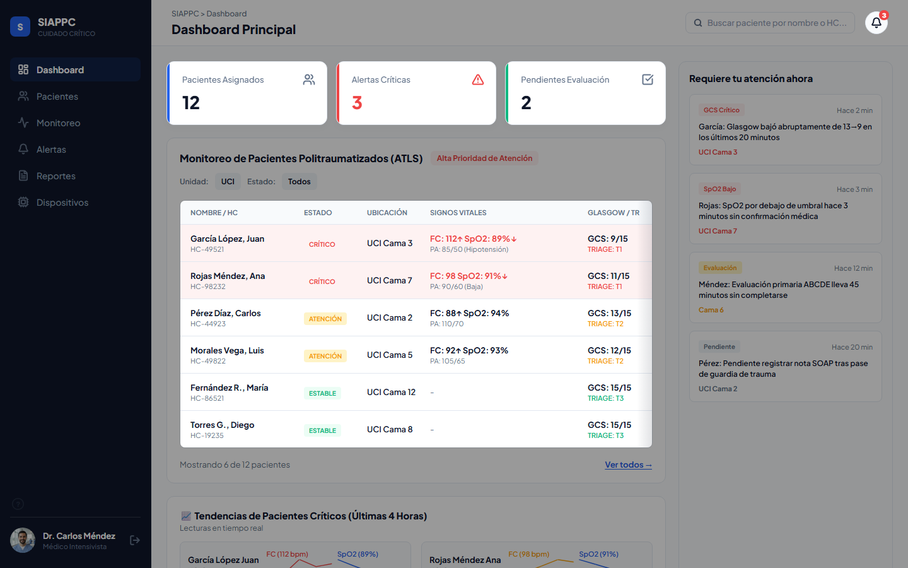
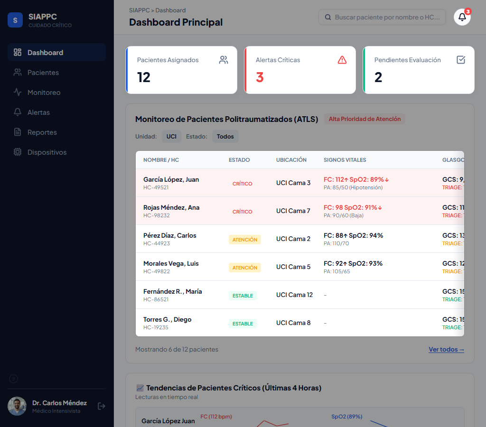
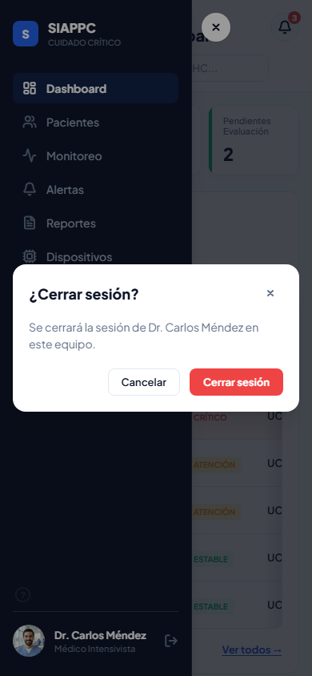
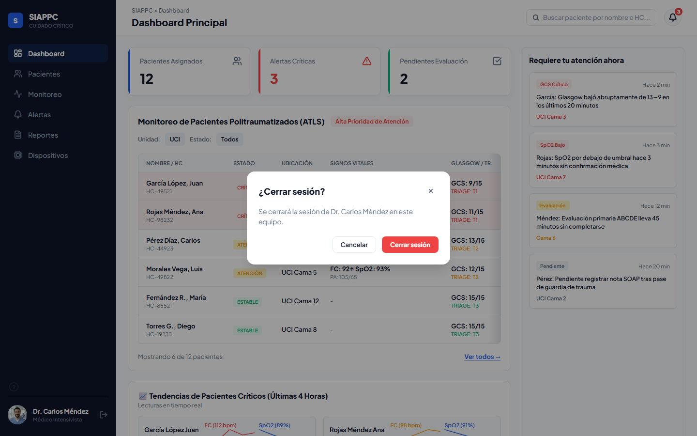
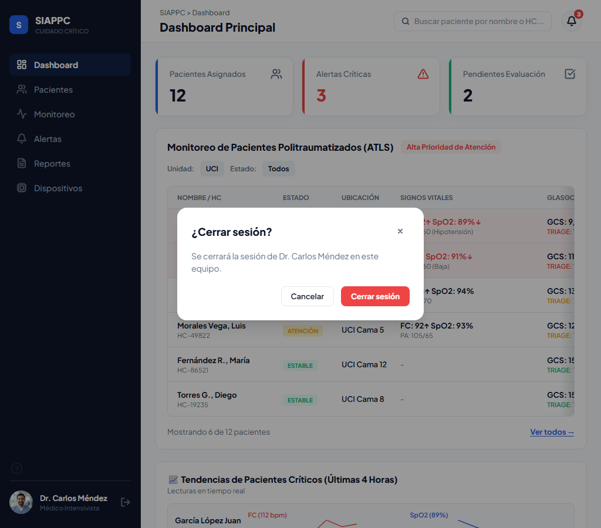
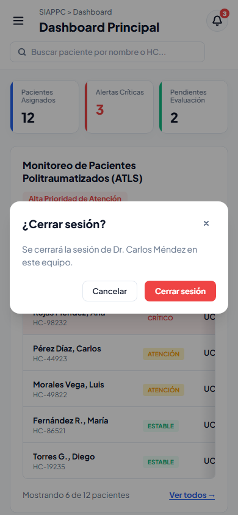

# Revisión — 8 pacientes del seed, capa `src/api/`, módulos de IA y cerrar sesión

> **Estado: aprobada ("Aprobar todo").** Se hace en tres PRs (sección 8).
> - **PR 1, cerrar sesión: hecho** (sección 6, con las capturas del después).
> - **PR 2, los 8 pacientes y la capa `src/api/`: hecho** (sección 9, con lo que cambió respecto de lo aprobado).
> - **PR 3, la IA: hecho** (sección 11). **La IA de `dev` cambió después de aprobar esto** (PRs #54–#58): lo que
>   cambia del plan está en la sección 10, y manda sobre las secciones 3 a 5.
>
> El plan para conectar con el backend real está aparte, en `CONEXION-BACKEND.md`.

Este paso termina el prototipo como **segunda app**, aparte de `frontend/`, lista para conectarse después al backend
real. Cuatro partes:

1. Trabajar con los **8 pacientes de `backend/db/seed-demo.sql`** (DEMO-0001…0008) y quitar a María González.
2. Agregar los **módulos de IA** (consulta libre y análisis automático), con un servicio `src/api/ai.ts` igual al de
   `frontend/` y un simulador que imita al backend.
3. Arreglar **cerrar sesión**, que hoy no se ve.
4. Dejar escrito el plan de conexión (`CONEXION-BACKEND.md`).

Lo publicado en https://prototipo.melo-coton.uk sigue funcionando sin backend: el modo por defecto es `mock`.

---

## Decisiones que necesito que apruebes

| # | Decisión | Propuesta |
|---|---|---|
| D1 | Paciente en la URL | `?paciente=DEMO-0002` (la cédula del seed, no el id numérico). Sin parámetro se abre **DEMO-0002**, el caso más parecido al de Figma (crítica, disnea). |
| D2 | Foto del paciente | La foto de María no sirve para 8 personas distintas: se cambia por un **círculo con iniciales** del mismo tamaño. |
| D3 | Rótulo del estado intermedio | Figma dice "Monitoreo" en unas pantallas y "Atención" en otras. Se usa **"Atención"** en todas, como `frontend/`. |
| D4 | Central de monitoreo | Un selector **Unidad: UCI / Trauma / Piso 3** en la barra superior (`?unidad=`, como `frontend/`). UCI muestra 6 camas, igual que Figma. |
| D5 | Centro de alertas | Los 8 pacientes traen 168 alertas del seed, casi repetidas (una por minuto). Se agrupan: **una fila por paciente y signo**, con el último valor y "18 avisos en 40 min". |
| D6 | Mock en la capa HTTP | El simulador responde a las **mismas rutas** del backend (`/patients`, `/ai/assist/stream`…). Los servicios son copias de los de `frontend/`. Pasar a real = cambiar `VITE_API_MODE`. |
| D7 | React Query | Se agrega **`@tanstack/react-query`** (la misma que usa `frontend/`) para caché, recargas cada 30 s del análisis de IA y refresco al firmar una nota. |
| D8 | Firma con texto de la IA | Si la nota tiene texto que vino de la IA, "Guardar y firmar" pide marcar **"Revisé el texto sugerido por la IA"**. |
| D9 | División en PRs | **Tres PRs** en orden: cerrar sesión → pacientes + `src/api/` → IA (sección 8). |

---

## 1. Los 8 pacientes

### Quiénes son (datos del seed)

La edad se calcula al pintar. El estado sale de la **peor alerta abierta**, con la misma regla que `frontend/`
(`clinicalState`: crítica → Crítico; alta o media → Atención; si no, Estable).

| Cédula | Paciente | Edad | Cama | Estado | Motivo y diagnóstico | Alergia | IA automática |
|---|---|---|---|---|---|---|---|
| DEMO-0001 | Rogelio Batista Quintero | 68 M | UCI-01 | Atención (FC 132, SpO₂ 88 %) | Fiebre, confusión y dolor lumbar · IVU complicada / sepsis | Penicilina | Sí (alta) |
| DEMO-0002 | Ileana Montenegro Sáez | 55 F | UCI-02 | Crítico (SpO₂ 83 %) | Disnea súbita 5 días tras cirugía de cadera · TEP presuntivo | — | Sí (crítica) |
| DEMO-0003 | Anselmo Ruiz Cardoza | 72 M | UCI-03 | Crítico (SpO₂ 84 %) | EPOC reagudizada | Sulfonamidas | Sí (crítica) |
| DEMO-0004 | Darío Vallejo Pinto | 30 M | TR-01 | Crítico (FC 149) | Politrauma en moto · trauma abdominal cerrado, fractura de fémur | Látex | Sí, pero al principio "aún sin análisis" |
| DEMO-0005 | Yamileth Orozco Arce | 81 F | UCI-04 | Crítico (FC 35) | Mareo y casi desmayo · bradicardia con digoxina, FA crónica | AINEs | Sí (crítica) |
| DEMO-0006 | Teodoro Lasso Mejía | 60 M | UCI-05 | Crítico (FC 150) | Palpitaciones y opresión torácica · taquicardia paroxística | — | Sí (crítica) |
| DEMO-0007 | Paloma Esquivel Núñez | 39 F | P3-01 | Estable | Neumonía adquirida en la comunidad, en mejoría | Ibuprofeno | No (sin alertas) |
| DEMO-0008 | Cristian Barrios Tello | 47 M | P3-02 | Estable | Pancreatitis aguda | — | No (sin alertas) |

Totales que salen de aquí: **8 pacientes, 5 críticos, 1 en atención, 2 estables**. Médico tratante de los 8:
**Carlos Méndez** (`medico@institucion.org`, unidad UCI), que ya es el usuario del pie del menú.

### De dónde sale cada dato

Cada paciente vive en un archivo `src/api/mock/seed/DEMO-000X.ts` con dos bloques: `delSeed` (copiado tal cual) e
`inventado`, que lleva el comentario **`// no viene del seed`**.

| Del seed, tal cual | Inventado (no está en el seed), coherente con cada caso |
|---|---|
| Nombre, cédula, nacimiento, sexo, grupo sanguíneo, contacto de emergencia ("Familiar de prueba (555-01xx)"), motivo de consulta, hora de llegada (relativa a ahora, como el `NOW()` del seed), estado | **Presión arterial y temperatura**: el backend no las tiene (`lectura.valor` es un número y nadie publica `temp`) |
| Observaciones del expediente ("Ingresa por cuadro séptico…") | **Glasgow, peso, talla y exploración física** (6 de 8; DEMO-0004 y DEMO-0006 quedan con "evaluación pendiente", como el KPI de Figma) |
| Antecedentes, alergias (reacción y severidad), medicamentos (dosis, vía, frecuencia, indicación) | **Notas SOAP** (1 a 3 por paciente, firmadas por Carlos Méndez; la última coincide con las lecturas) y **nota de ingreso** |
| Diagnósticos (CIE-10, descripción, presuntivo/definitivo/diferencial) | **Interrogatorio por aparatos**, **indicaciones no farmacológicas** (dieta, soluciones, laboratorios, cuidados) |
| Ingreso: cama, unidad, tipo (urgencia), fecha | **Documentos** (títulos de laboratorio, imagen, consentimiento) e **historial de hospitalizaciones y procedimientos** |
| Dispositivo: `DEMO-DEV-01…08`, modelo "Monitor de prueba", simulado | **Paneles del monitoreo detallado**: neurológico, respiratorio, balance hídrico, laboratorios, perfusión |
| Lecturas de FC, SpO₂ y FR: 41 por signo, una por minuto, últimos 40 min | **Tendencias antes de esos 40 min** (hasta 24 h atrás, empalmadas con el primer valor del seed) y la **forma de onda del ECG** |
| Alertas: tipo, severidad, mensaje, estado (abierta/reconocida) y hora | **Umbrales por paciente** (arrancan en los del backend: FC 50–120, SpO₂ ≥ 90, FR 8–30), **seguro médico**, firmware y calibraciones de los monitores |
| Médico tratante (`medico_paciente`) y cuentas de `seed.sql` (médico, enfermera Lucía Ramos, administrativo, admin) | **Entregas de turno**, **historial de reportes**, notificaciones que no son alertas, y la **receptora del turno** (Dra. Ana Gómez, de Figma) |

Las lecturas no se mueven solas: muestran el último valor del seed y "hace X s". En el backend real llegan por MQTT.

### El paciente va en la URL

- Todas las pantallas del expediente leen `?paciente=DEMO-000X`. Pestañas, botones y enlaces internos lo conservan; las
  listas, el monitoreo, las alertas, la búsqueda y el turno lo ponen al abrir un paciente.
- Se combina con lo que ya existía: `?paciente=DEMO-0002&nota=1`, `?paciente=DEMO-0004&cama=TR-01`.
- **Sobrevive a recargar** porque está en la URL. Sin parámetro se abre DEMO-0002 y la URL se corrige (sin dejar
  entrada en el historial), así que recargar también lo conserva.
- Una cédula que no existe muestra **"Paciente no encontrado"** (el 404 del backend) con "Ver mis pacientes".
- Ruta, título y cabecera usan el nombre: "SIAPPC > Pacientes > Ileana Montenegro Sáez > Notas SOAP".
- **Por qué la cédula y no el id:** el id numérico depende del orden en que se cargó la base; la cédula es la misma en
  todas. Con el backend real, el servicio traduce cédula → id con la lista de pacientes (una llamada, en caché).

### Pantallas que cambian y relleno que se quita

El diseño de Figma se queda; cambia el contenido. Donde Figma pagina, se conserva su **tamaño de página** (6 filas):
la paginación sigue funcionando con datos reales en vez de relleno.

| Pantalla | Hoy | Después |
|---|---|---|
| Dashboard | KPI 12 / 3 / 2; tabla "6 de 12"; 4 avisos y 2 gráficas de García y Rojas | KPI calculados: **8 asignados / 5 críticos / 2 pendientes de evaluación**; tabla "6 de 8" ordenada por gravedad, con filtro de unidad; avisos a partir de las alertas del seed y las evaluaciones pendientes; gráficas de los 2 críticos con alerta más reciente |
| Mis Pacientes | 12 de relleno | Los 8 (2 páginas de 6) |
| Central — Grid / Lista | 6 camas de relleno | Por unidad (D4). **UCI**: UCI-01…05 y UCI-06 libre (el seed la deja libre) = 6 tarjetas, como Figma. **Trauma**: TR-01, TR-04 y TR-05 libres. **Piso 3**: P3-01, P3-02 y P3-08 libre. Las camas de los otros 10 pacientes del seed no se cargan (comentado en el código) |
| Comparativa | Francisco Díaz, Sofía Martínez… | Los 8; arranca con los críticos |
| Centro de alertas | Alertas de relleno | Alertas del seed de los 6 con alertas, agrupadas (D5); contadores calculados |
| Confirmación de atención | Datos fijos | Los de la alerta elegida |
| Notificaciones (centro y bandeja) | Relleno | Las alertas del seed, como hace el backend (`alertaCritica`/`alertaTemprana`); las de otro tipo de Figma, inventadas |
| Dispositivos y detalle | 12 monitores | Los 8 del seed (2 páginas de 6) |
| Reportes | 18 en el historial | Reportes de los 8 (inventados), "6 de 8" |
| Entrega de turno | 5 filas, "7 pacientes" | Los 6 con alertas; resumen calculado "8 pacientes a cargo · 5 críticos · 1 en atención · 2 estables"; notas reescritas |
| Historial de entregas | 24 entregas | Se quedan las 24 (30 días de historia, inventadas): no nombran pacientes, así que no contradicen a los 8 |
| Resumen de turno recibido | Relleno | Los 8 |
| Búsqueda | "González" | Abre con **"Batista"**: un paciente, una nota y un documento, con las mismas reglas que el backend (paciente por nombre o cédula, nota por su texto, documento por su título) |
| Mi Perfil | Carlos Méndez | Igual (coincide con el seed); correo `medico@institucion.org` |
| 18 pantallas del expediente | María González | El paciente de la URL, con sus datos |

**Aviso para quien hace la sección del administrador:** `src/data/devices.ts` conserva **todas sus exportaciones**
(`DEVICES`, `STATUS_TONE`, `deviceByBed`, `deviceDetailPath`, `calibrationsOf`, `eventsOf`, `firmwareOf`,
`lastSeenOf`) con la misma forma, pero pasa de 12 monitores a los **8 del seed** (`DEMO-DEV-01…08`, camas UCI-01…,
TR-01, P3-01, P3-02). Si esa sección muestra monitores, verá estos 8.

---

## 2. La capa `src/api/` y el simulador

Regla: **las pantallas no tienen datos escritos**. Llaman a servicios de `src/api/` con las mismas funciones,
parámetros y tipos que `frontend/src/modules/*/api/*.ts` y sus `types.ts`.

```
src/api/
  mode.ts            API_MODE = 'mock' | 'real'   (VITE_API_MODE; si falta, 'mock')
  http.ts            copia de frontend/src/shared/api/http.ts: send, request, requestList, ApiError, token en sessionStorage.
                     En modo real llama a fetch('/api' + ruta); en modo mock, al simulador. Es la ÚNICA diferencia.
  auth.ts            ← auth/api/authApi.ts      login, logout, getStoredUser  (+ getMe para GET /auth/me)
  patients.ts        ← patients/api/patientsApi.ts   listPatients, getPatient, listAssignments
  clinical.ts        ← clinical/api/clinicalApi.ts, soapNoteApi.ts, antecedentesApi.ts, exploracionApi.ts
  ai.ts              ← clinical/api/aiApi.ts     getAiAnalysis, streamAiAssist (y sus tipos)
  dashboard.ts       ← dashboard/api/dashboardApi.ts   listAssignedPatients, listDeviceStatus
  monitoring.ts      ← monitoring/api/monitoringApi.ts y bedApi.ts
  sensors.ts         ← sensors/api/sensorsApi.ts      listReadings, listAlerts
  notifications.ts   ← notifications/api/notificationsApi.ts
  reports.ts         ← reports/api/reportsApi.ts y exportApi.ts
  search.ts          ← search/api/searchApi.ts
  alertStream.ts     ← shared/api/alertStream.ts  (GET /alerts/stream)
  sinBackend.ts      lo que el backend todavía no tiene: umbrales, entrega de turno, interrogatorio, nota de ingreso,
                     paneles del monitoreo detallado, reportes clínicos. Siempre simulado; cada función dice qué endpoint falta.
  types/             copias de los types.ts de frontend/ (auth, patients, clinical, dashboard, monitoring, sensors,
                     notifications, reports, search y lo que se use de admissions), con la ruta de origen arriba.
  mock/
    router.ts        tabla "método + ruta → manejador". Devuelve un Response con el mismo código, el mismo cuerpo
                     ({ error } en los errores) y las mismas cabeceras (X-Total-Count) que el backend.
    db.ts            estado en memoria; lo que se escribe (notas, exploración, observaciones, umbrales) se guarda
                     en sessionStorage, así que sobrevive a recargar y se limpia al cerrar la pestaña.
    seed/            DEMO-0001.ts … DEMO-0008.ts (sección 1), camas libres y cuentas de seed.sql.
    session.ts       login simulado y la matriz de permisos copiada de backend/db/seed.sql.
    ai.ts            respuestas de la IA por paciente y marcos SSE (sección 4).
    delay.ts         retrasos realistas: listas 250–600 ms, detalle 150–350 ms, escrituras 400–800 ms.
```

**Por qué el simulador va en la capa HTTP (D6):** los servicios quedan idénticos a los de `frontend/` (por ejemplo,
`streamAiAssist` lee los mismos marcos SSE que manda el backend), así que el simulador prueba también el código
que se usará contra el backend. Cambiar a real no toca ninguna pantalla.

**Errores que imita el simulador** (mismo formato `{ error: string }`):

| Código | Cuándo |
|---|---|
| 401 | Sin sesión en modo real, o sesión vencida (`?sesion=vencida` para probarlo) |
| 403 | La matriz de `seed.sql` no da el permiso: la enfermera en `/ai/*` o al crear una nota SOAP |
| 404 | Cédula o nota que no existe |
| 429 | Más de 10 consultas a la IA por minuto (el límite del backend) |
| 503 | IA no disponible (`?ia=caida`) |

**Interruptores para demostrar y probar** (se guardan en sessionStorage para toda la visita):
`?ia=lenta` (tiempos reales: 30 s a 1,5 min), `?ia=caida` (503 antes de empezar), `?ia=corte` (marco `error` a
mitad), `?ia=sin-analisis` (ningún paciente tiene análisis), `?retraso=0` (sin esperas, para las pruebas).

**Sesión en modo mock:** el Login acepta cualquier dato, como hoy. Si el correo es una de las cuentas de
`seed.sql`, entra con ese rol (`enfermero@institucion.org` sirve para ver la IA sin permiso); cualquier otro entra
como el médico. Sin sesión, una URL directa entra como el médico, para que los enlaces al prototipo publicado sigan
funcionando. El usuario del pie del menú sale de la sesión (`CURRENT_USER` se conserva como respaldo).

**Pasar a real:** compilar con `VITE_API_MODE=real` y poner el proxy de `/api` (detalle en `CONEXION-BACKEND.md`).
Las pantallas no cambian. Lo de `sinBackend.ts` sigue simulado hasta que exista su endpoint.

---

## 3. Dónde va la IA en las pantallas del médico

Todo lo de IA es nuevo (en Figma no hay diseño de IA): cada pieza lleva al inicio el comentario
`// No viene de Figma: …` y vive en `src/components/ai/`. Solo la ve quien tiene el permiso `asistente_ia`
(el médico sí; la enfermera no). La sección del administrador no tiene IA clínica.

| Pantalla | Qué se agrega | Por qué |
|---|---|---|
| **Menú lateral** | "Asistente IA" después de Alertas → `/MedAsistenteIa` | La consulta libre sirve también sin paciente (dudas generales) |
| **Dashboard** | Nada en la tabla. En "Requiere tu atención ahora", bajo las alertas de pacientes con análisis: "✦ La IA propuso 3 hipótesis · hace 4 min" → Resumen del paciente | Ese panel es "qué hago ahora", y el análisis lo disparó esa misma alerta. La tabla ya va llena |
| **Cabecera del paciente** | Botón "✦ Consultar IA" junto a "Generar Reporte": abre la consulta en un panel lateral con el paciente ya elegido | Una sola entrada desde las 18 pantallas del expediente, donde está el contexto |
| **Pestañas del paciente** | Nada (sin pestaña "IA") | Nada de la IA queda en el expediente |
| **Resumen** | Tarjeta "Ideas de la IA" bajo el monitor de signos vitales (hoy ahí hay espacio vacío), solo si el paciente tiene alerta alta o crítica | Es la vista de "cómo está y qué hago" |
| **Monitoreo Grid y Lista** | Nada | Se miran de lejos y las tarjetas ya van llenas; tocar la cama abre el Resumen, donde están las ideas |
| **Monitoreo detallado** (monitor de cama) | Tarjeta compacta de ideas bajo el monitor, solo si el paciente está **crítico** | Es lo que pidió la especificación y lo que hace `frontend/` (`BedMonitorPage`) |
| **Centro de alertas** | Nada en la lista | Ahí se decide qué atender; las ideas aparecen al atender |
| **Confirmación de atención** | Desplegable cerrado "Ideas de la IA para este paciente (3)", solo lectura | Ayuda a decidir, pero la confirmación registra lo que se hizo, no hipótesis: no se copian |
| **Nota SOAP nueva** | Bandeja "Sugerencia de la IA — sin revisar" cuando se llega con "Llevar a la nota", y las ideas automáticas en un desplegable | Es el único lugar donde una sugerencia entra al expediente, y entra escrita por el médico (sección 5) |
| **Registro de diagnóstico** | Tarjeta "Hipótesis de la IA (sin confirmar)" bajo "Diagnósticos previos", con "Buscar en CIE-10", que pone el texto en el buscador | Acelera la búsqueda del código; no registra nada sola |
| **Indicaciones médicas** | Botón "✦ Revisar interacciones con IA": abre el panel y pregunta "Revisa alergias e interacciones de sus medicamentos activos" | El aviso del backend pide verificar dosis, alergias e interacciones antes de indicar: es ese momento |
| **Búsqueda** | Nada | Mezclar respuestas de la IA con resultados del expediente confunde qué está registrado y qué no |
| Tendencias, Historia, Documentos, Turno, Reportes, Dispositivos, Notificaciones, Perfil | Nada | No hay una decisión clínica que la IA ayude a tomar ahí |

**Pantalla `/MedAsistenteIa`** (nueva, `?paciente=` opcional). A 1440, dos columnas:

- **Izquierda:** paciente (buscador con los 8 y "Sin paciente — consulta general"), preguntas frecuentes de un clic
  (las 5 de `frontend/`: diferenciales, banderas rojas, estudios, alergias e interacciones, manejo inicial), cuadro de
  pregunta (hasta 5000 caracteres, Ctrl+Enter), "Consultar" / "Detener" y la respuesta.
- **Derecha, "Lo que verá la IA":** edad, alergias, medicamentos, diagnósticos, últimos signos y últimas 3 notas SOAP.
  Es lo mismo que el backend le manda al modelo (`patientContext`); así el médico sabe con qué datos responde.

A 1024 la columna derecha baja; a 390 todo va en una columna. El **panel lateral** usa la misma consulta: 480 px a la
derecha (pantalla completa en celular), sobre la pantalla actual, con el contexto plegado.

---

## 4. Piezas nuevas y sus estados

| Pieza (`src/components/ai/`) | Qué es |
|---|---|
| `AiConsult` | La consulta libre: paciente, preguntas frecuentes, pregunta, respuesta y acciones |
| `AiConsultPanel` + `useAiPanel()` | El panel lateral; se abre desde cualquier pantalla con `{ paciente, pregunta? }` |
| `AiAnswer` | Muestra el Markdown de la respuesta (títulos, negritas, listas), sin interpretar HTML |
| `AiIdeasCard` | El análisis automático; variantes: completa (Resumen), compacta (Monitoreo), desplegable (Confirmación y SOAP), CIE-10 (Registro) |
| `AiSuggestionTray` | La bandeja de la nota SOAP |
| `AiDisclaimer` | El aviso del backend, en todas: *"Sugerencia generada por IA. No sustituye el juicio clínico; verifique dosis, alergias e interacciones antes de indicar."* |
| `IconSparkles`, `IconStop`, `IconCopy` | Íconos nuevos en `icons.tsx` |

### Consulta libre (POST `/ai/assist/stream`)

| Estado | Qué se ve |
|---|---|
| **Vacío** | Preguntas frecuentes y "La IA usará el expediente, los signos vitales y las 3 últimas notas SOAP de {paciente}". Sin paciente: "Consulta general, sin datos de un paciente" |
| **Pensando** (antes del primer trozo) | "Pensando… 0:12", con líneas grises animadas, "El modelo local tarda entre 30 s y 1,5 min" y **Detener** |
| **Escribiendo** | El texto aparece a medida que llegan los trozos, con cursor; sigue **Detener** |
| **Respuesta** | Las 5 secciones del backend (banderas rojas, diferenciales, estudios, manejo, datos faltantes), el modelo y el aviso; acciones **Llevar a la nota**, **Copiar**, **Nueva consulta** |
| **Cancelada** | Se conserva lo escrito con "Consulta detenida: la respuesta está incompleta" y **Volver a preguntar**. "Llevar a la nota" se desactiva (no se lleva una respuesta a medias) |
| **Sin permiso** (403) | "No tiene permiso para consultar a la IA." Es lo que ve la enfermera si entra por la URL; en su menú no aparece |
| **IA no disponible** (503 antes de empezar, o marco `error` a mitad) | "El asistente de IA no está disponible en este momento. Intente más tarde." y **Reintentar**; si fue a mitad, lo escrito queda marcado como cortado |
| **Demasiadas consultas** (429) | "Demasiadas consultas seguidas. Espere un minuto." |
| **Paciente no encontrado** (404) | "No se encontró al paciente." y la lista para elegir otro |

**Respuestas del simulador:** en español, distintas por paciente y por tipo de pregunta, con sus alergias y
medicamentos. El modelo se anuncia como `medgemma-4b-it (simulado)`, para que nadie confunda la demo con el modelo
real. Ejemplo para DEMO-0001 (resumido):

> **1. Banderas rojas** — FC 132, SpO₂ 88 %, FR 30 con fiebre y confusión: cumple criterios de sepsis (qSOFA ≥ 2).
> Hipotenso al ingreso: descartar choque séptico.
> **2. Diagnósticos diferenciales** — 1) Sepsis de foco urinario / pielonefritis complicada (DM2, dolor lumbar);
> 2) Pionefrosis o absceso renal si no mejora en 48–72 h; 3) Neumonía asociada (SpO₂ en descenso).
> **3. Estudios** — Lactato, hemocultivos ×2 y urocultivo, procalcitonina, creatinina, gasometría; ecografía renal.
> **4. Manejo** — Cristaloides 30 mL/kg si hay hipoperfusión; noradrenalina si PAM < 65. **Alergia a penicilina
> (urticaria):** la ceftriaxona tiene reactividad cruzada baja; vigilar. **Suspender metformina** (acidosis láctica) y
> **enalapril** (hipotensión).
> **5. Datos faltantes** — Peso, creatinina basal, lactato, presión arterial actual.

Otros casos: TEP con enoxaparina profiláctica (DEMO-0002); objetivo de SpO₂ 88–92 % y alergia a sulfonamidas
(DEMO-0003); material sin látex y ácido tranexámico (DEMO-0004); toxicidad por digoxina con bisoprolol, potasio e INR
por warfarina, y nada de AINEs (DEMO-0005); taquicardia de complejo estrecho o ancho y antecedente familiar (DEMO-0006).

### Análisis automático (GET `/ai/assist/:patientId`)

Se pide cada 30 s, como `frontend/`. El backend lo guarda 15 min (`AI_AUTO_TTL_SECONDS=900`) y no se escribe en el
expediente.

| Estado | Qué se ve |
|---|---|
| **Cargando** | Tres líneas grises |
| **Con análisis** | "Disparado por alerta crítica", "hace 4 min · caduca en 11 min", de 2 a 4 hipótesis (título y justificación), el modelo y el aviso; acciones **Llevar a la nota** y **Preguntar más** (abre el panel con "Profundiza en: {hipótesis}") |
| **Desactualizado** | Además: "Hay una alerta más reciente; esperando un análisis nuevo" |
| **Aún sin análisis** | "La IA todavía no termina de analizar a este paciente. Se actualiza solo." Lo muestra DEMO-0004 durante su primer minuto, y todos con `?ia=sin-analisis` |
| **Caducado** | "No hay un análisis vigente." (el backend responde `null`, igual que si nunca hubo) |
| **Error** | "No se pudo cargar el análisis de la IA." y **Reintentar** |
| **Sin permiso** (403) | La tarjeta no se dibuja (igual que `frontend/`) |

---

## 5. Cómo pasa una sugerencia a la nota SOAP sin firmarse sola

1. **"Llevar a la nota"** abre un menú corto: qué llevar (respuesta completa o una sección: diferenciales, estudios,
   manejo; o las hipótesis del análisis) y a dónde (**Evaluación (A)** o **Plan (P)**).
2. Se abre **Nueva Nota SOAP** de ese paciente. La sugerencia viaja en sessionStorage, ligada a la cédula: sobrevive a
   recargar y no se pone texto clínico en la URL.
3. Arriba del formulario aparece la **bandeja "Sugerencia de la IA — sin revisar"**: origen (consulta u análisis), hora,
   modelo, el texto y el aviso, con **Insertar en Evaluación (A)**, **Insertar en Plan (P)** y **Descartar**.
4. **Insertar** agrega el texto, ya sin Markdown, al final de esa sección. El médico lo edita. Todavía no se guarda nada.
5. **Guardar borrador** funciona igual que hoy.
6. **Guardar y firmar**: si la nota tiene texto que vino de la IA (aunque se haya editado), la confirmación pide marcar
   **"Revisé el texto sugerido por la IA (dosis, alergias e interacciones)"**. Sin marcarla, "Firmar" queda desactivado.
7. Al backend solo llega lo de siempre: `createSoapNote({ …, sign: true })`. La sugerencia se borra al firmar, al
   descartar o al cerrar sesión. Una sugerencia de un paciente no aparece en la nota de otro.

---

## 6. Cerrar sesión

### Antes

El diálogo "¿Cerrar sesión?" se dibuja **dentro del `<aside>` del menú**. A partir de 1024 px ese menú va dentro de un
contenedor `sticky`, que crea su propio contexto de apilamiento: el `z-40` del diálogo solo vale ahí dentro, y las
tarjetas de la página, que vienen después, se pintan encima.

| 1440 px | 1024 px | 390 px (menú abierto) |
|---|---|---|
|  |  |  |
| El fondo se oscurece pero **el diálogo no se ve**: las tarjetas y la tabla quedan encima. Medido: el elemento visible en el centro del diálogo es un texto de la tabla | Igual | El diálogo se ve, pero encima del menú abierto, que se queda detrás con su X |

Lo demás funciona: "Cerrar sesión" lleva al Login y el aviso **"Sesión cerrada"** llega bien, porque `ToastProvider`
está fuera de las rutas (a 390 tapa unos segundos el pie del Login, y se acepta).

### Arreglo (desde la raíz) — hecho en el PR 1

1. **`Modal` se dibuja con un portal en `document.body`**. Lo heredan `ConfirmDialog`, `UploadDocumentModal`, la nota
   SOAP, el detalle SOAP y, después, el panel de IA. `Popover` (y `Menu`, que lo usa) ya usaban portal.
2. **Una sola escala de capas** en `tailwind.config.js`: `z-drawer` (menú de celular, 50), `z-modal` (ventana, 55),
   `z-popover` (lista desplegable, 60) y `z-toast` (aviso, 70). Antes la ventana (40) quedaba debajo del menú de
   celular (50).
3. **La confirmación sale del menú y la dibuja `AppLayout`** (`LogoutDialog`). En celular, tocar "Cerrar sesión" cierra
   el menú y abre la confirmación sobre la pantalla; si se quedara dentro del menú, al cerrarlo se desmontaría con él.
   `Sidebar` sin `onLogout` sigue abriendo la confirmación por su cuenta, por si otra pantalla lo usa suelto.
4. **`useLogout()`** (`src/components/auth/useLogout.ts`) junta el cierre: muestra "Sesión cerrada" y va a `/Login`
   reemplazando la pantalla actual en el historial. Ya es asíncrona: en el PR 2 se le agrega `logout()` de
   `src/api/auth.ts` (POST `/auth/logout`), borrar la sesión y la caché, y con la sesión las pantallas mandan al Login
   a quien ya salió, también con Atrás.

### Después

| 1440 px | 1024 px | 390 px (desde el menú abierto) |
|---|---|---|
|  |  |  |

Verificado: `npm run build` y `tsc` pasan; en los tres anchos el diálogo queda encima de todo (en tres puntos del
diálogo, el elemento visible es el diálogo), es hijo de `body` y en celular el menú ya está cerrado; Cancelar y Escape
lo cierran sin salir; confirmar lleva a `/Login` con "Sesión cerrada". Una lista desplegable abierta dentro de una
ventana (Subir documento) queda encima de ella. Las 40 pantallas a 1440 son iguales a la línea base (solo cambia la
cuenta regresiva de "Reenviar").

---

## 7. Archivos compartidos que se tocan

| Archivo | Cambio | ¿Afecta a la sección del administrador? |
|---|---|---|
| `src/App.tsx` | 1 ruta nueva (`/MedAsistenteIa`, PR 3) | No |
| `src/main.tsx` | Proveedores: datos (React Query) y, en el PR 3, panel de IA | Sí, para bien: también podrá usar `src/api/` |
| `src/App.tsx` | `SessionProvider` alrededor de las rutas (PR 2) | Sí: sus pantallas también piden sesión; `/Login` y la recuperación quedan públicas |
| `src/components/layout/nav.ts` | 1 entrada ("Asistente IA") con permiso; `CURRENT_USER` se queda como respaldo | Mínimo: el tipo `NavItem` gana un campo opcional |
| `src/components/layout/Sidebar.tsx` | Filtra por permiso; usuario de la sesión; "Cerrar sesión" avisa a `AppLayout` | Sí, si usa el mismo menú |
| `src/components/layout/AppLayout.tsx` | Diálogo de cerrar sesión y panel de IA | Sí (arreglo de cerrar sesión) |
| `src/components/ui/Modal.tsx`, `Popover.tsx`, `Toast.tsx`, `tailwind.config.js` | Portal y escala de capas | Sí: sus ventanas también dejarán de quedar tapadas |
| `src/components/patient/PatientHeader.tsx`, `PatientLayout.tsx` | Paciente de la URL, iniciales, botón de IA | No |
| `src/components/index.ts`, `icons.tsx` | Exportaciones e íconos nuevos | No (solo se agrega) |
| `src/data/devices.ts` | Los 8 monitores del seed; **mismas exportaciones** | Sí: ver aviso en la sección 1 |
| `src/data/alerts.ts`, `src/data/soap.ts` | Pasan a leer de `src/api/`; los tipos y rutas que exportan se conservan | No |
| `package.json`, `package-lock.json` | `@tanstack/react-query` | No |
| `vite.config.ts`, `.env.example` | Proxy de `/api` preparado (no se usa en mock) y `VITE_API_MODE` | No |
| Pantallas `Med*` y de acceso | Contenido desde `src/api/` | — (no se toca nada `Admin*`) |

No se toca `nginx.conf`, `Dockerfile` ni `docker-compose.yml` en este paso: en modo mock no hacen falta (ver
`CONEXION-BACKEND.md`).

### Qué se verá distinto de Figma a 1440 px

Además del contenido (nombres, valores, fechas): las iniciales en lugar de la foto (D2), "Atención" en lugar de
"Monitoreo" (D3), el selector de unidad (D4), la agrupación de alertas (D5), el botón "✦ Consultar IA" en la cabecera,
la entrada "Asistente IA" del menú, las tarjetas de ideas (Resumen y Monitoreo de pacientes con alertas, Registro de
diagnóstico) y el formulario de Registro de diagnóstico vacío (Figma lo muestra lleno con el caso de María). La
estructura de cada pantalla de Figma se conserva; se comparará contra la línea base tomada hoy.

---

## 8. Cómo dividir el trabajo

Es grande (unos 60 archivos). Propuesta: **tres PRs a `dev`, en este orden**. Al terminar cada uno me detengo y te doy
los comandos de git; tú lo subes y sigo con el siguiente.

| PR | Rama | Contenido | Tamaño |
|---|---|---|---|
| 1 | `feature/prototipo-cerrar-sesion` | Parte 3: portal, escala de capas, `useLogout`. Más `REVISION-IA.md`, `CONEXION-BACKEND.md` y las capturas del antes | ~8 archivos |
| 2 | `feature/prototipo-pacientes-ia` | Parte 1 y la capa `src/api/` con el simulador, React Query, sesión por rol, paciente en la URL | ~50 archivos |
| 3 | `feature/prototipo-ia` | Parte 2: `src/api/ai.ts`, simulador de IA, `src/components/ai/`, `/MedAsistenteIa`, ubicaciones de la sección 3, "Llevar a la nota" | ~20 archivos |

El PR 1 va primero porque es corto, no depende de nada y le sirve ya a quien hace la sección del administrador (sus
ventanas también quedan tapadas). Si prefieres **un solo PR** en `feature/prototipo-pacientes-ia`, lo hago en tres
commits con el mismo corte.

Cada PR cierra con: `npm run build`; capturas a 1440 comparadas con la línea base; revisión automática a 1440, 1024,
768 y 390 sin desplazamiento de lado ni textos que rompan el diseño; y sus pruebas automáticas:

- **PR 1:** cerrar sesión a 1440 y a 390 (con el menú abierto): el diálogo se ve encima de todo, "Cancelar" lo cierra,
  confirmar lleva al Login con el aviso y Atrás no vuelve.
- **PR 2:** las 8 fichas con todas sus pestañas; el paciente sobrevive a recargar; cédula inexistente → "no encontrado";
  listas, monitoreo, alertas, búsqueda y turno con los 8.
- **PR 3:** consulta libre (pensando → trozos → respuesta → llevar a la nota → insertar → firmar con la casilla);
  cancelar; IA no disponible; la enfermera no ve la IA; tarjeta de ideas en un paciente crítico; DEMO-0004 "aún sin
  análisis".

Al final: `PLAN.md` (8 pacientes, capa `src/api/`, paso "IA", el prototipo como segunda app, siguiente paso = conectar
según `CONEXION-BACKEND.md`), `BOTONES.md`, `LEEME.md` (hoy dice que `/` abre el Centro de Alertas y que no hay backend),
este archivo y `CONEXION-BACKEND.md`.

---

## 9. PR 2 — hecho

Rama `feature/prototipo-pacientes-ia`. Las pantallas del médico, la de Detalle de Monitor y el Login piden sus datos
a `src/api/`; ninguna tiene ya pacientes escritos ni a María González.

**Cómo quedó**

- `src/api/`: copias de los servicios y tipos de `frontend/` (cada archivo lo dice al inicio), `http.ts` con el
  interruptor de `mode.ts`, hooks de React Query en `queries.ts` y la matriz de permisos del seed en `permisos.ts`.
- `src/api/mock/`: el simulador. `router.ts` responde las mismas rutas, códigos y reglas que el backend (401 sin sesión,
  403 según el rol, 404, 409 al editar una nota firmada, 400 en la búsqueda con menos de 2 letras); `db.ts` arma el
  estado a partir de `seed/` (un archivo por paciente: `delSeed` tal cual del seed e `inventado`, marcado "no viene del
  seed"); lo que se escribe queda en `sessionStorage`.
- `src/api/sinBackend.ts`: lo que el backend todavía no tiene (PA y temperatura, nota de ingreso, interrogatorio,
  indicaciones no farmacológicas, entrega de turno, tendencias de más de 40 min, umbrales, avisos), siempre simulado
  aunque se conecte el backend. `CONEXION-BACKEND.md` dice qué tabla o ruta lo reemplazaría.
- Paciente en la URL (`src/lib/patientLink.ts`): `Button`, `Tabs`, `useRowLink` y `AppLink` agregan `?paciente=` a
  todo enlace del expediente. Sesión en `src/components/auth/session.tsx`.
- `vite.config.ts` trae el proxy de `/api` y `.env.example` el interruptor; en modo mock (lo publicado) no se usan.

**Diferencias con lo aprobado o con Figma**

1. **Paginación sin relleno.** Mis Pacientes: 5 por página, 2 páginas. Dispositivos: 8 por página (el tamaño de
   Figma), 1 página. Reportes: un reporte de ejemplo por paciente (8), 5 por página. El Historial de Entregas conserva
   sus 24 entregas: son registros de turno (3 por día), no pacientes.
2. **Dashboard con unidad "Todas" por defecto.** Figma muestra "UCI"; con UCI se verían 5 de 8 y faltarían el de
   Trauma y los 2 de Piso 3.
3. **Enfermería ve a los 8 en el simulador.** `/dashboard/assigned-patients` del backend usa la asignación del médico;
   el simulador se la da también al enfermero para que sus pantallas no queden vacías (comentado en `router.ts`). Con
   el backend real, el médico de prueba tiene 15 asignados (el seed trae 18 pacientes; el prototipo usa los 8 pedidos).
4. **Notificaciones inventadas.** El seed no trae ninguna: se arman a partir de las alertas (una por monitor, signo y
   gravedad) más asignaciones, laboratorio, imagen, recordatorio de borradores y sistema.
5. **Resumen del paciente: "Modelo" en lugar de "Señal"** en la tarjeta del dispositivo (el seed no trae la señal).
   El trazo de ECG es el de Figma (una línea, como en la línea base).
6. **Registro de diagnóstico vacío** con los tipos del enum `TipoDiagnostico` del backend (presuntivo, definitivo,
   diferencial); la gravedad y los hallazgos se guardan en `notas`, que es lo que el backend acepta.
7. **Exploración física con las 4 técnicas del backend** (inspección, palpación, percusión, auscultación) en todas las
   regiones; DEMO-0004 y DEMO-0006 no tienen exploración y lo dice un aviso.
8. **Login responde 400 con campos vacíos** (como el backend) y cualquier otra combinación entra; `?sesion=vencida`
   prueba el 401.
9. **"Tiempo resp. promedio" muestra "—"**: las alertas reconocidas del seed no traen cuándo se reconocieron
   (`resolvedAt` vacío), así que no hay de dónde calcularlo.
10. **La central de monitoreo en Grid usa un solo componente de tarjeta** (`src/components/monitor/BedCards.tsx`) en
    lugar de las 12 tarjetas copiadas de Figma; se ven igual.
11. **Glasgow pendiente** se muestra "GCS: —" (con la explicación al pasar el cursor) para que no se corte la columna.
12. **Imágenes de Figma que ya no se usan:** 36 más (fotos de pacientes, íconos de las tarjetas copiadas), que se
    suman a 207 que ya estaban sin uso desde el paso 1. Se dejan en `src/assets/` porque la rama del administrador
    podría usarlas; se pueden borrar cuando se una.

**Verificación**

- `npm run build` y `tsc` pasan; no queda "María" ni "González" en `src/`.
- Capturas a 1440 de las 40 rutas comparadas con la línea base del PR 1: cambia el contenido, no la estructura.
  Revisión automática a 1440, 1024, 768 y 390: sin desplazamiento de lado ni textos cortados o partidos de más
  (se arreglaron camas "UCI-01" en dos renglones, nombres largos cortados y siglas en minúscula en la entrega de turno).
- Pruebas automáticas (Edge sin ventana): las 8 fichas en sus 18 pantallas (nombre visible, nada "Cargando", ningún
  "undefined"/"NaN", todos los enlaces con su `?paciente=`, sin errores en consola); recargar conserva al paciente;
  sin `?paciente=` abre DEMO-0002; DEMO-9999 → "Paciente no encontrado"; Mis Pacientes 5 + 3; Dashboard 8; monitoreo
  por unidad (UCI, Trauma, Piso 3); alertas solo del seed; búsqueda "Batista" → paciente, nota y documento; turno con
  los 8; 8 monitores; cerrar sesión → Login con aviso, Atrás y enlace directo se quedan en Login; entrar como
  enfermero vuelve a la ficha pedida, sin "Nueva Nota SOAP".
- **Aviso para la sección del administrador:** `src/data/devices.ts` conserva sus exportaciones (`Device` gana `cedula`
  y `unit` opcionales); el contenido son los 8 monitores del seed. Sus pantallas quedan detrás de la sesión: el
  simulador entra como el médico y con `admin@institucion.org` como administrador (permisos de `permisos.ts`).

---

## 10. La IA nueva de `dev` (PRs #54 a #58) — qué cambia del plan

Después de aprobar las secciones 3 a 5, Adrian cambió la IA del backend y de `frontend/` (`backend/src/routes/ai.ts`,
`lib/clinicalAi.ts`, `services/aiAuto.ts`, `services/aiTemas.ts`; `frontend/…/aiApi.ts`, `AiIdeasCard.tsx`,
`AiConsultPage.tsx`) y el seed de demo. El PR 3 sigue el contrato nuevo; donde choca con lo aprobado, manda esto.

| # | Qué cambió en `dev` | Antes (aprobado) | Ahora en el PR 3 |
|---|---|---|---|
| C1 | **La consulta libre exige paciente.** `patientId` es obligatorio: sin él, 400 "Selecciona un paciente"; sin pregunta, 400 "Escribe la consulta" | `/MedAsistenteIa` ofrecía "Sin paciente — consulta general" | Sin esa opción. La pantalla abre con el paciente de `?paciente=` o pide elegirlo: "Para empezar, elija el paciente sobre el que quiere consultar." y "Consultar" y las preguntas rápidas quedan desactivadas. El simulador responde los mismos 400 |
| C2 | **La IA responde solo lo que se pregunta.** Un dato (edad, médico a cargo, cama, alergias) → una frase corta; "estudios" → solo estudios. Las 5 secciones (**Banderas rojas, Diferenciales, Estudios, Manejo, Datos faltantes**, 2–4 viñetas cada una) solo en preguntas abiertas ("¿qué tiene?", "analiza al paciente") | Siempre las 5 secciones | El simulador clasifica la pregunta igual (copia de las reglas de `aiTemas.ts`) y responde en ese formato. "Llevar a la nota" ofrece secciones solo cuando la respuesta las trae; si no, la respuesta completa |
| C3 | **El contexto va por temas.** Siempre: paciente, edad, sexo, sangre, motivo, estado, alergias, medicamentos y diagnósticos activos. Lo demás (signos y su tendencia de 6 h, alertas, exploración, antecedentes, notas, médico a cargo, cama, documentos…) solo si la pregunta lo toca; una pregunta que pide razonar recibe todo lo clínico | "Lo que verá la IA" mostraba un bloque fijo (últimas 3 notas, signos…) | "Lo que verá la IA" muestra lo mínimo siempre y marca qué secciones extra se mandan **para la pregunta escrita**, con las mismas reglas (`src/lib/aiTemas.ts`, copia de `backend/src/services/aiTemas.ts`) |
| C4 | **Ideas a pedido:** POST `/ai/assist/:patientId/ideas` genera ideas aunque el paciente no tenga alertas, con severidad `solicitado` ("A solicitud"); límite 5 por minuto; 503 si el modelo falla. El análisis queda guardado y GET `/ai/assist/:patientId` lo devuelve | La tarjeta solo leía el análisis automático y solo aparecía con alerta alta o crítica | `AiIdeasCard` lleva el botón **Generar ideas / Actualizar / Generando…** (como `frontend/`). En el **Resumen** aparece en los 8 pacientes (DEMO-0007 y DEMO-0008, sin alertas, empiezan vacíos y se pueden pedir); en el **Monitoreo detallado** sigue solo con el paciente crítico, como `BedMonitorPage` |
| C5 | **Ideas más cortas:** 2 o 3 hipótesis, título de hasta 6 palabras y justificación de hasta 15 que cita el dato ("SpO2 86 %, FR 28") | 2 a 4, con justificación libre | El simulador las escribe así |
| C6 | **Textos nuevos** de `frontend/`: no disponible "Por ahora el asistente de IA no está disponible. Puede intentarlo de nuevo en unos minutos."; sin permiso "Su cuenta todavía no tiene acceso al asistente de IA. Un administrador puede habilitarlo."; 429 "Se hicieron varias consultas seguidas. Espere un minuto y podrá continuar."; detenida "Detuvo la consulta. Aquí queda lo que se alcanzó a responder."; sin ideas "Todavía no hay ideas para este paciente. Puede pedirlas con «Generar ideas»." | Los textos de la sección 4 | Se usan los de `frontend/` |
| C7 | **El seed trae una nota SOAP firmada por paciente** (DEMO-0001…0008, hace 2 h, de Carlos Méndez) | Notas inventadas: 1 a 3 por paciente y un borrador en DEMO-0004 | `delSeed.ts` las trae tal cual (`notaSoap`) y el simulador usa **solo esas**: se quitaron las inventadas. Consecuencias: la búsqueda "Batista" ya no encuentra una nota (sí el paciente y el documento); no hay borrador al empezar, así que el recordatorio de "Nota SOAP sin firmar" aparece cuando se guarda uno; la IA ve 1 nota por paciente más las que se escriban |

Lo demás de las secciones 3 a 5 se mantiene: el panel lateral, "✦ Consultar IA" en la cabecera, las ubicaciones,
"Llevar a la nota" con la bandeja "sin revisar" y la casilla de D8, el modelo `medgemma-4b-it (simulado)` y los
interruptores `?ia=lenta|caida|corte|sin-analisis`.

---

## 11. PR 3 — hecho

Rama `feature/prototipo-ia`, con el contrato nuevo de la sección 10. Todo lo de IA es nuevo y cada archivo lo dice
al inicio ("No viene de Figma").

**Cómo quedó**

- `src/api/ai.ts`: copia del `aiApi.ts` de `frontend/` (`getAiAnalysis`, `generateAiIdeas`, `streamAiAssist`).
  `src/lib/aiTemas.ts`: copia de `backend/src/services/aiTemas.ts`.
- Simulador (`src/api/mock/ai.ts` y `iaRespuestas.ts`): `POST /ai/assist/stream` con los marcos `inicio`, `trozo`,
  `fin` y `error`; `GET /ai/assist/:id`; `POST /ai/assist/:id/ideas`. Tiene los mismos 400 ("Selecciona un
  paciente", "Escribe la consulta"), 404, 403 (enfermería), 429 (10 consultas y 5 pedidos de ideas por minuto) y
  503. El modelo se anuncia como `medgemma-4b-it (simulado)`.
- `src/components/ai/`:
  - `AiConsult` y `useAiConsult`: la consulta, con sus estados pensando, escribiendo, respuesta, detenida, error y
    cortada.
  - `AiPanel` y `useAiPanel`: el panel lateral.
  - `AiContext`: "Lo que verá la IA".
  - `AiIdeasCard`: variantes `full`, `compact`, `collapsible` y `cie10`.
  - `AiAnswer` y `AiDisclaimer`, `TakeToNote` ("Llevar a la nota"), `AiSuggestionTray` y `aiSuggestion.ts`
    (sessionStorage por cédula).
  - `useAiAccess`: permiso `asistente_ia` y que el rol no sea admin.
- Pantalla nueva `/MedAsistenteIa` y entrada "Asistente IA" en el menú.
- **Dónde aparece la IA:**
  - "Consultar IA" en la cabecera del paciente.
  - Ideas en el Resumen (los 8) y en el Monitoreo detallado (solo críticos).
  - Desplegable de solo lectura en Confirmación de atención y en la Nota SOAP nueva.
  - Hipótesis con "Buscar en CIE-10" en Registro de diagnóstico.
  - "Revisar interacciones con IA" en Indicaciones.
  - "La IA propuso N hipótesis" en el Dashboard.
- **Nota SOAP:**
  - La bandeja "sin revisar" con Insertar en A / P / Descartar.
  - Si la nota tiene texto de la IA, "Firmar" queda desactivado hasta marcar "Revisé el texto sugerido por la IA
    (dosis, alergias e interacciones)" (D8).
  - La sugerencia se borra al firmar, al descartar y al cerrar sesión.

**Archivos compartidos que se tocaron** (además de los de IA): `App.tsx` (`AiPanelProvider` y 1 ruta),
`layout/nav.ts` (1 entrada; `NavItem` gana `perm` y `hideFor`, opcionales), `layout/Sidebar.tsx` (filtra por
permiso), `components/index.ts` y `icons.tsx` (solo se agrega), `ui/Modal.tsx` (`ConfirmDialog` gana
`confirmDisabled`, opcional), `form/Combobox.tsx` (gana `search`, opcional) y `auth/session.tsx` (al salir borra
las sugerencias). `main.tsx` no cambia: el panel necesita el router y va en `App.tsx`. Para la sección del
administrador: nada de lo suyo cambia de forma; el admin no ve la IA.

**Diferencias con lo aprobado** (además de la sección 10)

1. **"Lo que verá la IA" no se pide al servidor:** el backend no expone `patientContext`. Se arma en el navegador
   con los mismos datos (expediente, signos, notas) y las mismas reglas de temas; si el backend cambia esas reglas,
   hay que volver a copiar `aiTemas.ts`.
2. **"Desactualizado"** se marca como en `frontend/`: solo si llega por el flujo una alerta del paciente más nueva
   que el análisis. El simulador no genera alertas nuevas, así que en la demo no se ve.
3. **El análisis automático del simulador se renueva cada 10 min** ("hace 4 min" al abrir): en el backend las
   alertas siguen llegando y lo vuelven a disparar. Sin esto caducaría a los 15 min con la página abierta.
4. **"Buscar en CIE-10"** escribe la palabra de la hipótesis que encuentra menos códigos sin quedar en cero
   ("Tromboembolia pulmonar…" → "embolia"). El buscador de CIE-10 busca texto, no frases.
5. **La búsqueda global sigue abriendo con "Batista"**, que ahora da el paciente y el documento (C7).

**Verificación**

- `npm run build` y `tsc` pasan.
- Capturas a 1440, 1024, 768 y 390: ninguna pantalla se sale de lado. Las únicas marcas son los recortes y saltos
  de línea aceptados en el PR 2.
- Pruebas automáticas de IA (Edge sin ventana), todas pasan:
  - **Consulta:**
    - Sin paciente, pide elegirlo y no deja consultar.
    - "Manejo inicial" pasa por pensando y escribiendo, y responde solo el manejo, con la bandera roja.
    - Un dato ("¿quién es el médico a cargo y en qué cama está?") da una frase, y "Lo que verá la IA" agrega médico
      y cama.
  - **Estados:**
    - Detener: queda "Detuvo la consulta" y "Llevar a la nota" desactivado.
    - `?ia=caida`: aviso y "Reintentar".
    - `?ia=corte`: lo escrito queda marcado como cortado.
  - **Ideas:**
    - DEMO-0004 empieza sin ideas.
    - DEMO-0003 (crítico) muestra 3 hipótesis con el aviso.
    - Monitoreo detallado: ideas solo en el crítico.
    - "Generar ideas" en DEMO-0007 da "A solicitud".
  - **Nota SOAP:**
    - "Llevar a la nota" → insertar en A → firmar exige la casilla; sin texto clínico en la URL y sin sugerencias
      al terminar.
    - La sugerencia sobrevive a recargar y no aparece en la nota de otro paciente.
  - **Otras pantallas:** Indicaciones abre el panel y pregunta sola; "Buscar en CIE-10"; "La IA propuso…" en el
    Dashboard; el desplegable de la Confirmación.
  - **Enfermería:** no ve el menú, el botón ni las ideas, y por URL ve el aviso del 403.
  - **Cerrar sesión:** borra las sugerencias.
- **Pruebas del PR 2 de nuevo:**
  - Recarga, cédula inexistente, listas (con la búsqueda ajustada por C7) y sesión.
  - Las 8 fichas en sus 18 pantallas.
